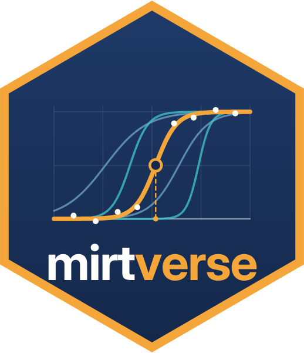

# mirtverse 

<!-- badges: start -->
[](https://doi.org/10.5281/zenodo.23719384)
[](https://github.com/okanbulut/mirtverse/actions/workflows/R-CMD-check.yaml)
[](https://okanbulut.r-universe.dev/mirtverse)
<!-- badges: end -->

**mirtverse** is a friendly workflow and reporting layer for the
[mirt](https://philchalmers.github.io/mirt/) package. mirt estimates item response
theory (IRT) models; mirtverse helps you choose a model, understand the results,
make publication-ready figures, and share everything, with or without writing R code.

> **New: interactive teaching labs.** Four browser-based labs let students fit
> live mirt models and make real testing decisions, from choosing a model to
> advising a certification board, investigating a fairness complaint and
> linking two forms of an exam. Start one with `run_lab("model-choice")`, or
> read [Teaching labs](https://www.okanbulut.com/mirtverse/articles/teaching-labs.html).

## About mirt

[mirt](https://philchalmers.github.io/mirt/), developed and maintained by
[Dr. R. Philip Chalmers](https://chalmers.info.yorku.ca/), is one of the most comprehensive open-source packages for item
response theory. It was introduced in the *Journal of Statistical Software*
([Chalmers, 2012](https://doi.org/10.18637/jss.v048.i06)) and has been developed continuously since, with version 1.48
released on CRAN in October 2026. It is widely used in research on educational
and psychological measurement.

mirt can:

- **Estimate a wide range of models:** unidimensional and multidimensional,
  exploratory and confirmatory, bifactor and two-tier, with more than 30 item types
  (Rasch, 2PL to 4PL, graded response, (generalized) partial credit, nominal,
  ideal-point, nonparametric spline items and more), plus user-defined items.
- **Handle complex designs:** multiple-group analysis and measurement invariance,
  mixed-effects and explanatory IRT (`mixedmirt()`), and latent class and
  diagnostic classification models (`mdirt()`).
- **Use several estimation engines:** EM with fixed or quasi-Monte Carlo
  quadrature, and the Metropolis-Hastings Robbins-Monro (MHRM) algorithm for
  high-dimensional models, with several standard-error methods.
- **Check and use the models:** item and person fit, limited-information fit (M2),
  local dependence, DIF and differential test functioning, and ability estimation
  (EAP, MAP, ML, WLE, plausible values).

mirtverse leaves all of this untouched and adds the workflow, interpretation and
reporting tools around it.

## What mirtverse adds

| Feature | Functions |
|---|---|
| Point-and-click workbench with R code export | `launch_workbench()` |
| Analysis scripts written from a plain-language request | `mv_ask()`, `mv_ask_setup()`, `run_script()` |
| Model selection assistant | `select_model()` |
| Differential item functioning in one call | `dif()`, `gg_dif()` |
| Plain-language interpretation | `interpret()`, `interpret_prompt()` |
| Tidy outputs | `tidy()`, `glance()`, `augment()`, `item_table()` |
| ggplot2 graphics, including Wright maps | `gg_trace()`, `gg_info()`, `gg_wright()`, `gg_itemfit()`, `gg_q3()`, `gg_scores()`, `gg_empirical()`, `autoplot()` |
| Item health cards | `item_card()`, `item_cards()` |
| One-call HTML report | `mv_report()` |
| Results dashboard to share with non-R users, as a Shiny app or one offline HTML file | `mv_dashboard()`, `export_dashboard()` |
| Response-time modelling and rapid-guessing detection | `fit_rt()`, `sim_rt()` |
| Interactive teaching labs for measurement courses (learnr) | `run_lab()`, `list_labs()` |
| Translate ltm, eRm, TAM and irtQ code into mirt code | `mirtify()`, `mirtify_crosswalk()` |

## Installation

Install a prebuilt version from r-universe (no Rtools or GitHub token needed):

```r
install.packages("mirtverse", repos = c("https://okanbulut.r-universe.dev", "https://cloud.r-project.org"))
```

Or install the development version from GitHub:

```r
# install.packages("remotes")
remotes::install_github("okanbulut/mirtverse")
```

## A five-minute tour

```r
library(mirtverse)

data <- expand.table(LSAT7)

sel <- select_model(data)   # compares Rasch, 2PL and 3PL and recommends one
mod <- sel$best             # an ordinary mirt model

interpret(mod)              # what the results mean, in plain language
tidy(mod)                   # parameters as a data frame
item_table(mod)             # item statistics, fit and flags in one table

gg_wright(mod)              # person-item map
item_card(mod, "Item.2")    # one-page item review

mv_report(sel, file = "report.html")   # everything in one HTML file
mv_dashboard(mod, title = "LSAT results")   # interactive dashboard to share
```

Prefer clicking? Run `launch_workbench()`. Prefer describing the analysis in
words? `mv_ask("fit a 2PL, check DIF by gender and make a report", data = mydata)`
writes the whole script for you.

Teaching a measurement course? `run_lab("model-choice")` opens an interactive
lab in which students work through a realistic testing scenario with live
models (see [Teaching labs](https://www.okanbulut.com/mirtverse/articles/teaching-labs.html)).

## Cheat sheet

<a href="https://www.okanbulut.com/mirtverse/cheatsheet/mirtverse-cheatsheet.pdf"></a> <a href="https://www.okanbulut.com/mirtverse/cheatsheet/mirtverse-cheatsheet.pdf"></a>

A printable two-page [cheat sheet (PDF)](https://www.okanbulut.com/mirtverse/cheatsheet/mirtverse-cheatsheet.pdf)
covers the main functions by task: page 1 for analysis and sharing, page 2 for
the assessment pipeline.

## Coming from ltm, eRm, TAM or irtQ?

`mirtify()` rewrites code written for these packages as mirt code, without
running the original, and adds a comment wherever the packages differ (for
example, conditional versus marginal likelihood in eRm, or the scaling
constant `D = 1.702` in irtQ):

```r
mirtify({
  library(eRm)
  fit <- RM(raschdat1)
  pp <- person.parameter(fit)
  itemfit(pp)
  LRtest(fit)
})
```

It translates the model calls and the usual next steps (scores, item and
person fit, plots, Andersen's LR test), and `run = TRUE` also runs the result.
In the package tests, most translated models reproduce the original estimates
to within about 0.006. `mirtify_crosswalk()` lists every supported function.
See [Moving from ltm, eRm, TAM or irtQ to mirt](https://www.okanbulut.com/mirtverse/articles/mirtify.html).

## Relationship to mirt

**mirtverse depends on mirt and never changes how models are estimated**. Every
function accepts a model created with `mirt::mirt()`, so you can move between the
two packages at any point. Please cite mirt (Chalmers, 2012) whenever you use
mirtverse.

Chalmers, R. P. (2012). mirt: A multidimensional item response theory package for the
R environment. *Journal of Statistical Software, 48*(6), 1-29. <https://doi.org/10.18637/jss.v048.i06>

## Citation

If you use mirtverse, please cite it together with mirt. Run `citation("mirtverse")` in R, or use:

Bulut, O. (2026). *mirtverse: A friendly workflow and reporting layer for 'mirt'* (Version 0.2.0) [R package]. Zenodo. https://doi.org/10.5281/zenodo.23836292

To cite all versions, use <https://doi.org/10.5281/zenodo.23719384>, which always resolves to the latest release.
