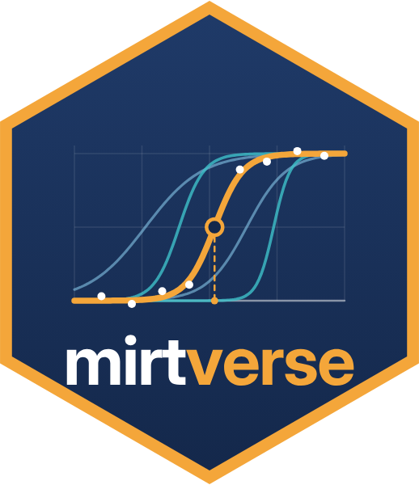
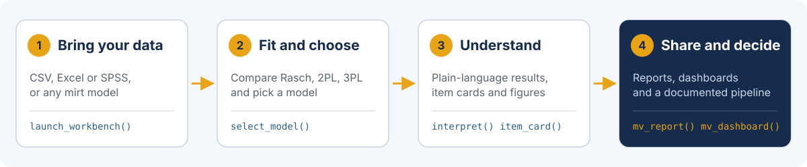
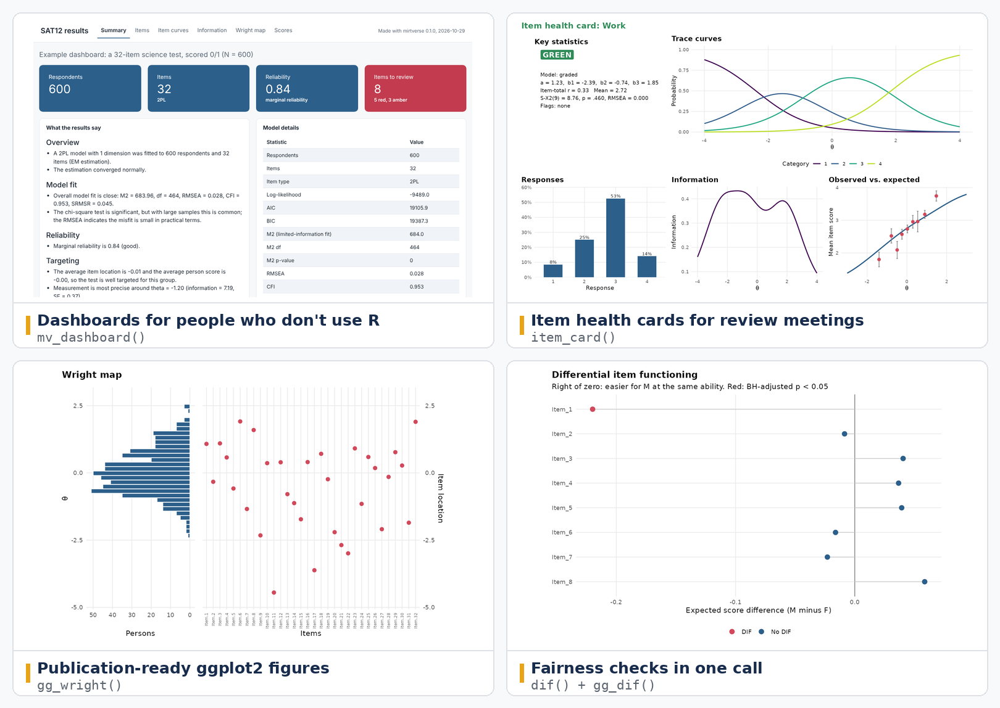
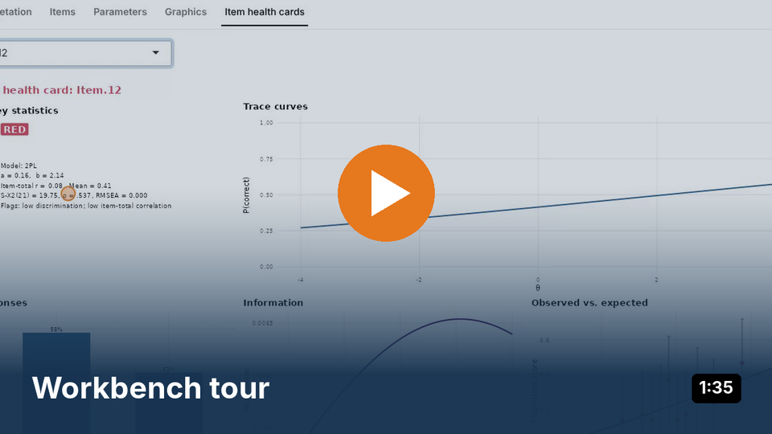
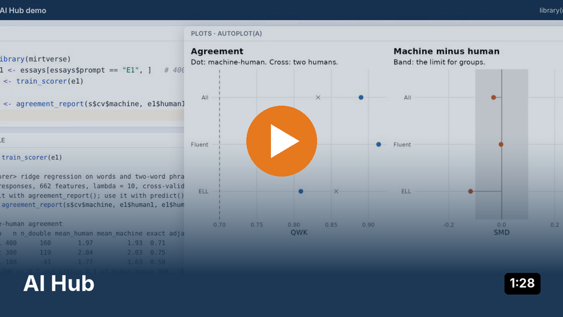
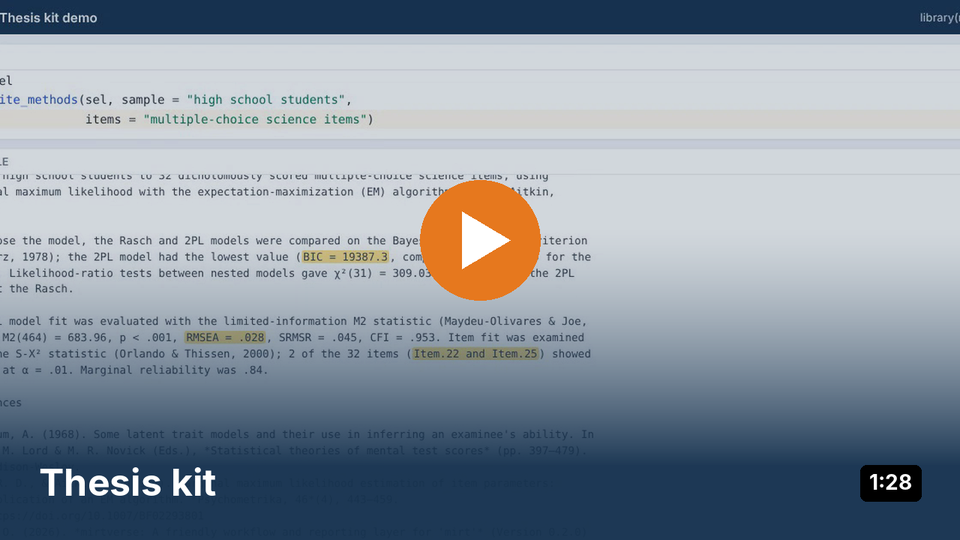

# mirtverse 

<!-- badges: start -->
[](https://doi.org/10.5281/zenodo.23719384)
[](https://github.com/okanbulut/mirtverse/actions/workflows/R-CMD-check.yaml)
[](https://okanbulut.r-universe.dev/mirtverse)
<!-- badges: end -->


**From item responses to defensible decisions, with or without writing R code.**

*Türkçe:* [mirtverse'e Türkçe giriş](https://www.okanbulut.com/mirtverse/articles/tr.html) ve [Türkçe başvuru kartı (PDF)](https://www.okanbulut.com/mirtverse/cheatsheet/mirtverse-cheatsheet-tr.pdf).

**mirtverse** is a friendly workflow and reporting layer for the
[mirt](https://philchalmers.github.io/mirt/) package by R. Philip Chalmers.
mirt estimates item response theory (IRT) models; mirtverse helps you choose a
model, understand the results, make publication-ready figures, and share
everything with people who never open R.



<a href="https://www.okanbulut.com/mirtverse/articles/gallery.html"></a>

**Try it without installing anything:** [Open the live example dashboard](https://www.okanbulut.com/mirtverse/dashboard/sat12-demo.html)
or browse the [Gallery](https://www.okanbulut.com/mirtverse/articles/gallery.html) of figures and outputs.

**Or watch a short demo** (about 90 seconds each, with captions):

<a href="https://youtu.be/huSxZzaFNs0"></a>
<a href="https://youtu.be/4cFjnpSkcMQ"></a>
<a href="https://youtu.be/J3us00sk34g"></a>

## Find your way in

| I am... | Start here |
|---|---|
| A student learning IRT or analysing thesis data | [Students](https://www.okanbulut.com/mirtverse/articles/for-students.html) · [Thesis kit](https://www.okanbulut.com/mirtverse/articles/thesis-kit.html) |
| An instructor teaching measurement (book, ten labs, sample syllabus) | [Instructors](https://www.okanbulut.com/mirtverse/articles/for-instructors.html) · [Adopt for your course](https://www.okanbulut.com/mirtverse/articles/adopt.html) |
| A psychometrician at a testing or credentialing program | [Testing programs](https://www.okanbulut.com/mirtverse/articles/for-practitioners.html) · [Case study](https://www.okanbulut.com/mirtverse/articles/case-study.html) |
| A researcher who already uses mirt, ltm, eRm, TAM or irtQ | [Researchers](https://www.okanbulut.com/mirtverse/articles/for-researchers.html) · [Moving to mirt](https://www.okanbulut.com/mirtverse/articles/mirtify.html) |
| New to R, or coming from Winsteps, SPSS or Excel | [New to R](https://www.okanbulut.com/mirtverse/articles/for-new-to-r.html) |
| Curious about AI in measurement | [AI Hub](https://www.okanbulut.com/mirtverse/articles/ai-hub.html): Book chapters, labs and a workshop kit |

Not sure which IRT model fits your data? The [Which IRT model? flowchart](https://www.okanbulut.com/mirtverse/articles/which-model.html) goes from what one item score looks like to a model and the line of R code that fits it ([printable poster](https://www.okanbulut.com/mirtverse/which-model/which-irt-model.pdf)).

<a href="https://www.okanbulut.com/mirtverse/articles/ai-hub.html"></a>

## Get started

```r
install.packages("mirtverse", repos = c("https://okanbulut.r-universe.dev", "https://cloud.r-project.org"))
# Development version: remotes::install_github("okanbulut/mirtverse")

library(mirtverse)

data <- expand.table(LSAT7)

sel <- select_model(data)   # compares Rasch, 2PL and 3PL and recommends one
mod <- sel$best             # an ordinary mirt model

interpret(mod)              # what the results mean, in plain language
item_table(mod)             # item statistics, fit and flags in one table
gg_wright(mod)              # person-item map
item_card(mod, "Item.2")    # one-page item review

mv_report(sel, file = "report.html")        # everything in one HTML file
mv_dashboard(mod, title = "LSAT results")   # interactive dashboard to share
```

Prefer clicking? Run `launch_workbench()`, which writes the R code for you.
Every function is listed in the [Reference](https://www.okanbulut.com/mirtverse/reference/), and the
[cheat sheet (PDF)](https://www.okanbulut.com/mirtverse/cheatsheet/mirtverse-cheatsheet.pdf) groups them by task.

## Beyond the usual IRT toolkit

- **Describe the analysis, get the script.** `mv_ask("fit a 2PL, check DIF by gender and make a report", data = mydata)`
  writes a tested R script from one sentence, with Claude, an OpenAI model, a
  local model or an offline parser. [How it works](https://www.okanbulut.com/mirtverse/articles/mv-ask-guide.html)
- **Let Claude run the analysis.** The mirtverse plugin for Claude Code turns
  Claude into a psychometrician that fits models, checks items and DIF,
  scores people, explains the results and leaves a report and an R script,
  all with mirtverse on your own computer:
  `/plugin marketplace add okanbulut/mirtverse`, then
  `/plugin install mirtverse@mirtverse`.
  [The mirtverse agent](https://www.okanbulut.com/mirtverse/articles/mirtverse-agent.html)
- **Generate items.** `generate_items()` drafts multiple-choice items with keys
  and open-ended items with rubrics from a test blueprint, and
  `generate_isomorphs()` builds item families from an item model.
  [Book chapter](https://www.okanbulut.com/mirtverse/book/aig.html)
- **Score open-ended responses.** `train_scorer()` trains a transparent scoring
  engine that runs offline, and `score_open()` scores with it or with a
  language model, checking agreement with human raters before any score is used.
  [Book chapter](https://www.okanbulut.com/mirtverse/book/auto-scoring.html)
- **Run a whole testing program.** `mv_pipeline()` takes a test from blueprint
  to bank monitoring in 13 stages, with flags that catch problems before the
  next step. [The pipeline](https://www.okanbulut.com/mirtverse/articles/assessment-pipeline.html) ·
  [Case study](https://www.okanbulut.com/mirtverse/articles/case-study.html)

## About mirt

[mirt](https://philchalmers.github.io/mirt/), developed and maintained by
[Dr. R. Philip Chalmers](https://chalmers.info.yorku.ca/), is one of the most
comprehensive open-source packages for item response theory. It estimates
unidimensional and multidimensional models with more than 30 item types,
multiple-group and mixed-effects models, and latent class and diagnostic
models, with EM and MHRM estimation, fit statistics, DIF and ability estimation.

**mirtverse depends on mirt and never changes how models are estimated.** Every
function accepts a model created with `mirt::mirt()`, so you can move between
the two packages at any point.

## Citation

Please cite mirtverse together with mirt. Run `citation("mirtverse")` in R, or use:

Bulut, O. (2026). *mirtverse: A friendly workflow and reporting layer for 'mirt'* (Version 0.2.0) [R package]. Zenodo. https://doi.org/10.5281/zenodo.23836292

Chalmers, R. P. (2012). mirt: A multidimensional item response theory package for the
R environment. *Journal of Statistical Software, 48*(6), 1-29. <https://doi.org/10.18637/jss.v048.i06>

To cite all versions of mirtverse, use <https://doi.org/10.5281/zenodo.23719384>,
which always resolves to the latest release. The online book has its own DOI:
[10.5281/zenodo.23885605](https://doi.org/10.5281/zenodo.23885605).
