# Gallery

Each figure below is made by the code above it, with data that ships
with mirt or mirtverse. Every plot is a ggplot2 object, so you can
change its theme, labels and colours with ordinary ggplot2 code.

``` r

library(mirtverse)
data <- expand.table(LSAT7)
mod <- mirt(data, 1, itemtype = "2PL", verbose = FALSE)
```

## Outputs to share

These run in a browser with nothing installed.

| Output | Made with | Example |
|----|----|----|
| Interactive results dashboard | [`mv_dashboard()`](https://www.okanbulut.com/mirtverse/reference/mv_dashboard.md), [`export_dashboard()`](https://www.okanbulut.com/mirtverse/reference/export_dashboard.md) | [Open the live dashboard](https://www.okanbulut.com/mirtverse/dashboard/sat12-demo.md) |
| Printable cheat sheet | Two pages, by task | [PDF](https://www.okanbulut.com/mirtverse/cheatsheet/mirtverse-cheatsheet.pdf) |
| Interactive teaching labs | [`run_lab()`](https://www.okanbulut.com/mirtverse/reference/run_lab.md) | [Teaching labs](https://www.okanbulut.com/mirtverse/articles/teaching-labs.md) |
| Online book | Worked examples and exercises | [Read the book](https://www.okanbulut.com/mirtverse/book/index.md) |

[](https://www.okanbulut.com/mirtverse/dashboard/sat12-demo.md)

## Choosing a model

[`select_model()`](https://www.okanbulut.com/mirtverse/reference/select_model.md)
compares candidate models and explains its choice.

``` r

sel <- select_model(data)
autoplot(sel)
```

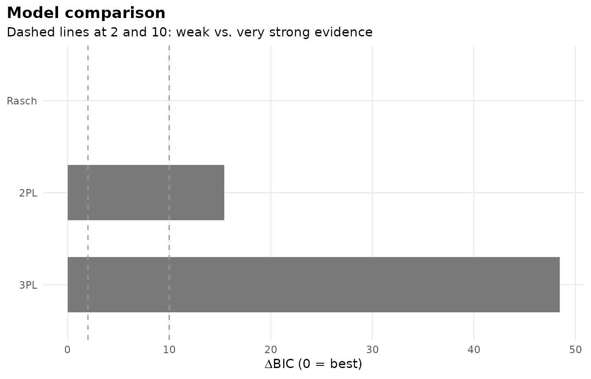

## Item curves

``` r

gg_trace(mod)
```

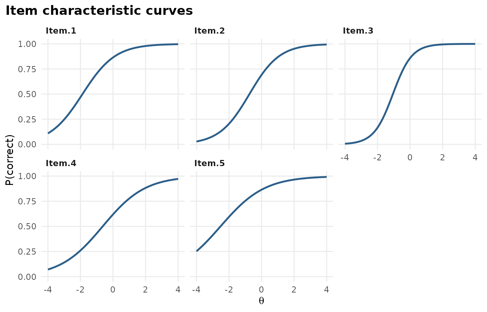

## Test and item information

``` r

gg_info(mod)
```

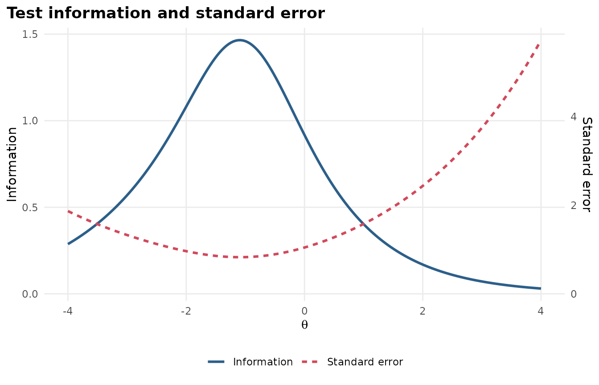

``` r

gg_info(mod, type = "items")
```

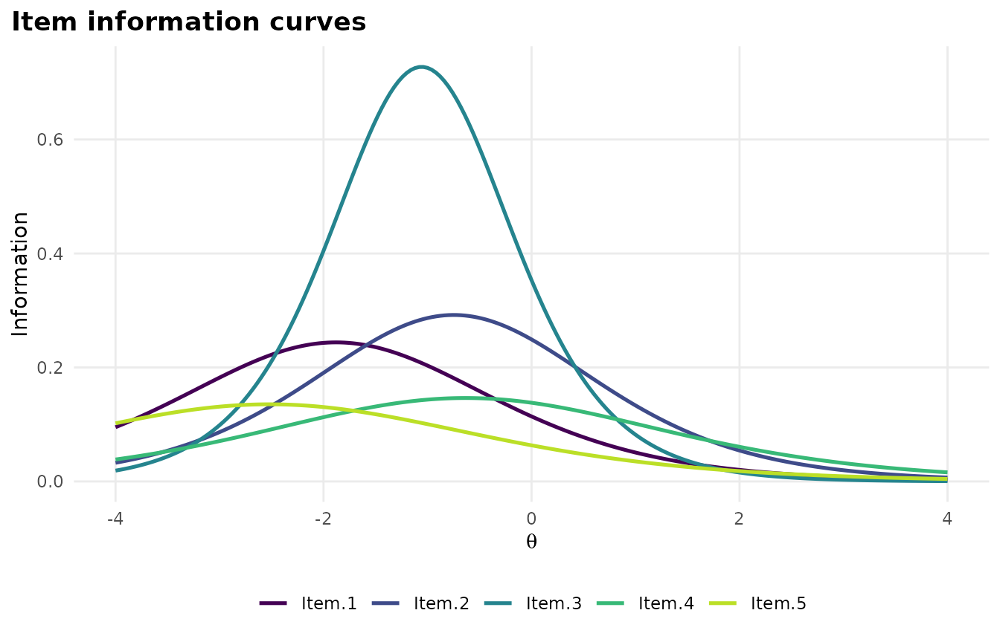

## Wright map

People and items on one scale.

``` r

gg_wright(mod)
```

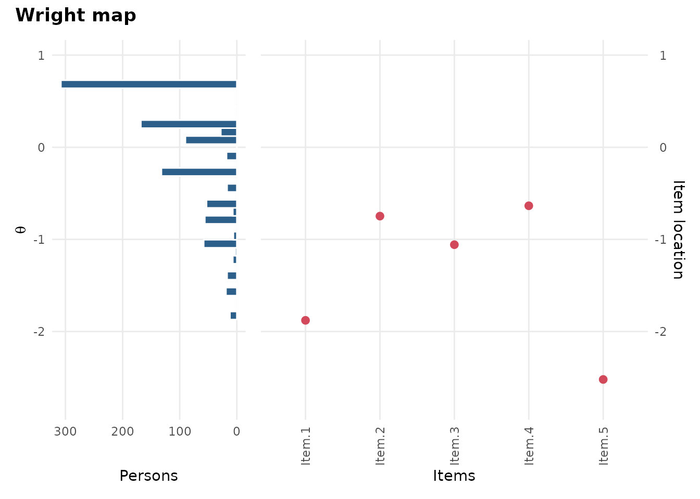

## Item fit

``` r

gg_itemfit(mod)
```

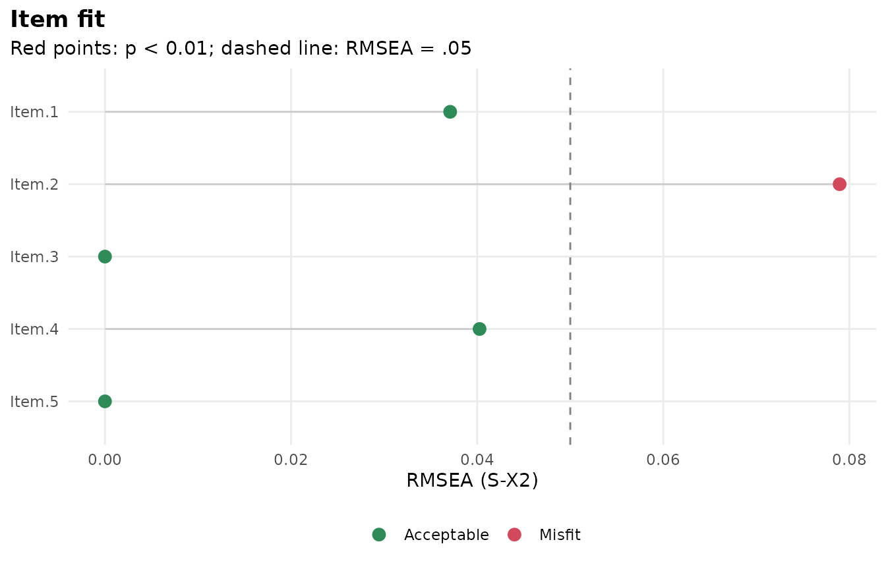

## Observed versus expected

``` r

gg_empirical(mod, item = 3)
```

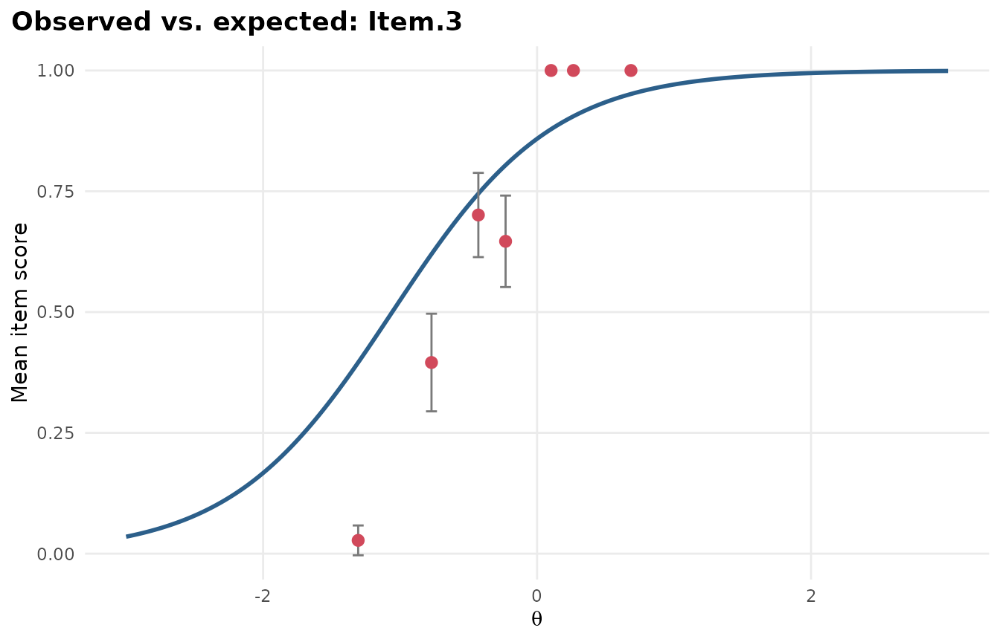

## Local dependence

``` r

gg_q3(mod)
```

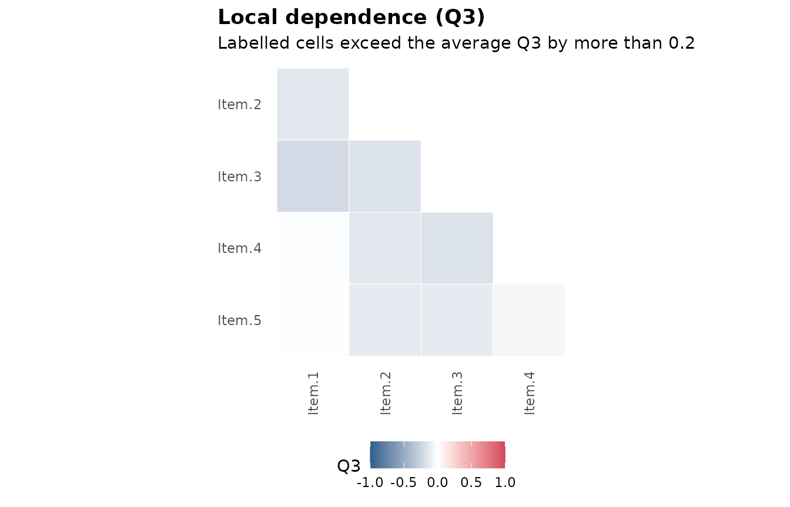

## Score distribution

``` r

gg_scores(mod)
```

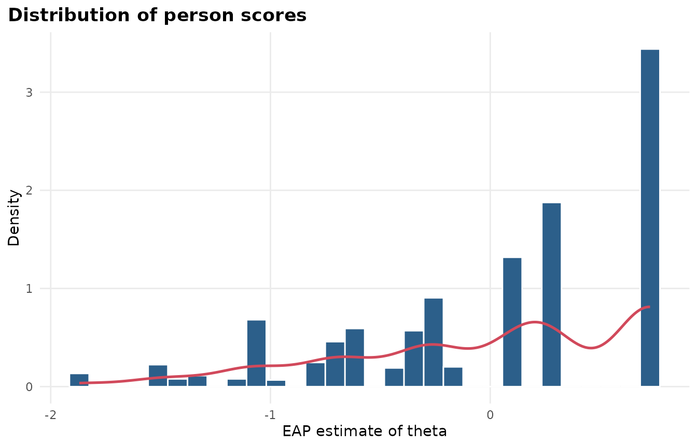

## Item health card

A one-page summary of a single item for review meetings, with a
traffic-light status.

``` r

sci <- mirt(Science, 1, verbose = FALSE)
item_card(sci, "Work")
```

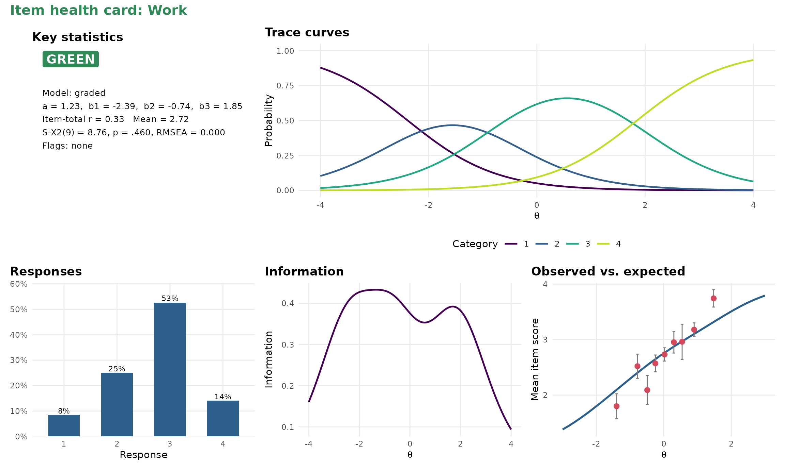

## Differential item functioning

``` r

set.seed(1)
a <- matrix(rlnorm(8, 0.2, 0.3)); d <- matrix(rnorm(8))
d2 <- d; d2[1] <- d2[1] - 1
dif_data <- rbind(simdata(a, d, 400, itemtype = "2PL"),
                  simdata(a, d2, 400, itemtype = "2PL"))
res <- dif(dif_data, group = rep(c("F", "M"), each = 400))
gg_dif(res)
```

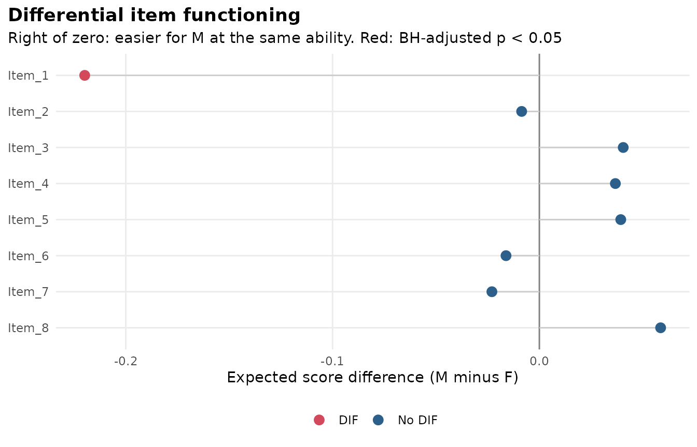

## Response times

``` r

sim <- sim_rt(N = 500, J = 10, rapid = 0.05, seed = 1)
rt_mod <- mirt(sim$responses, 1, verbose = FALSE)
fit <- fit_rt(rt_mod, sim$rt)
autoplot(fit)
```

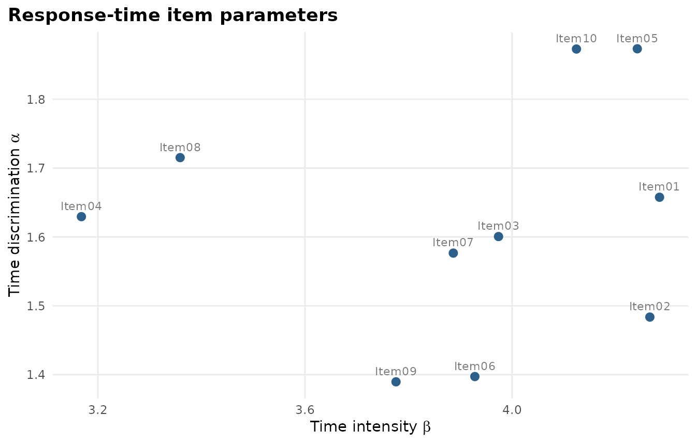

## Teaching labs

The labs run in RStudio’s viewer or a browser. See [Teaching
labs](https://www.okanbulut.com/mirtverse/articles/teaching-labs.md) for
all ten.

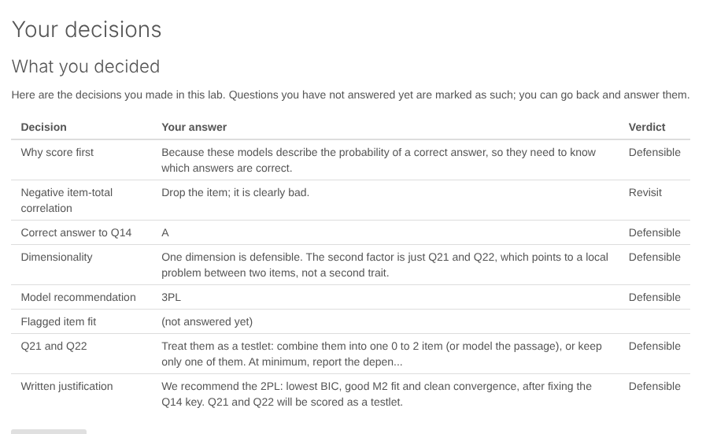

A decision screen from Lab 2.
