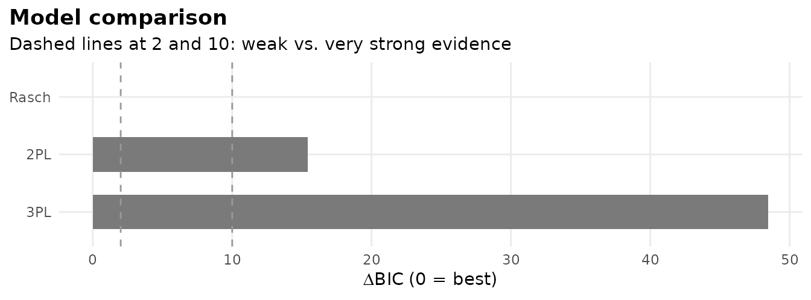
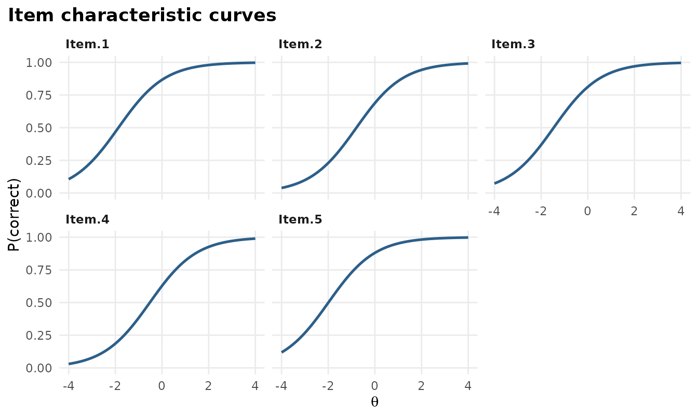
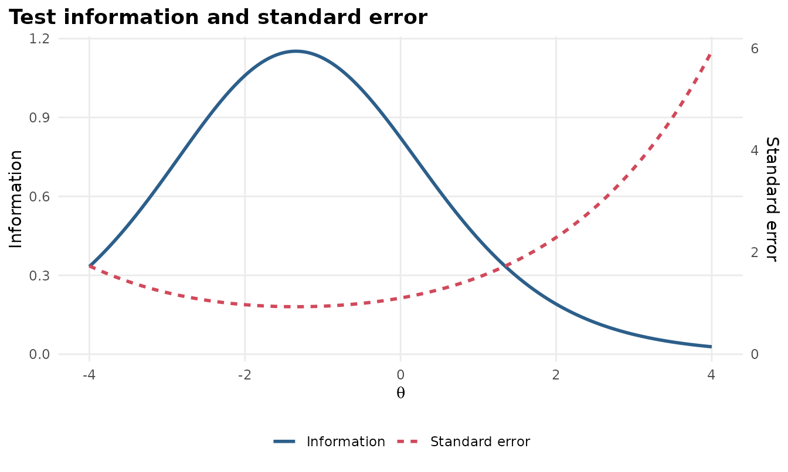
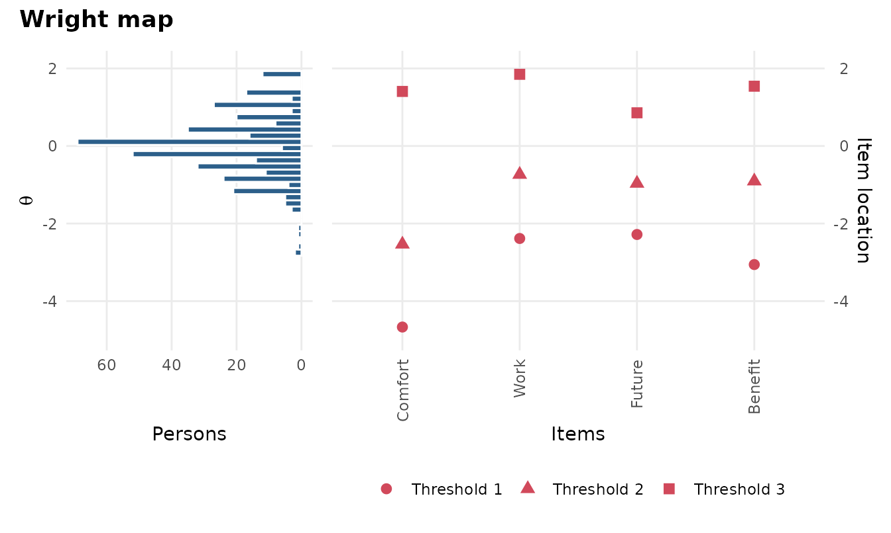
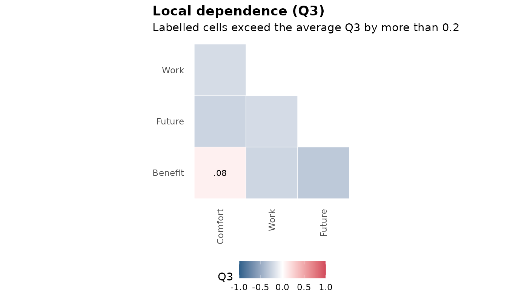
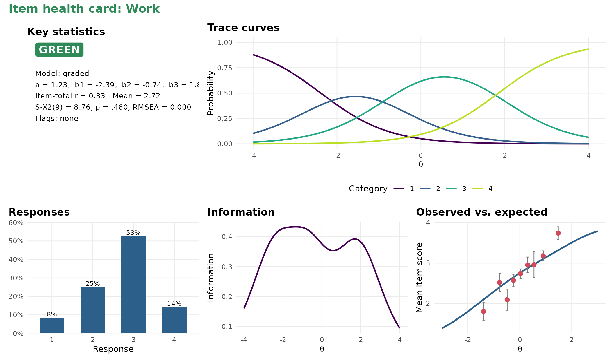

# Getting started with mirtverse

mirtverse sits on top of [mirt](https://philchalmers.github.io/mirt/).
mirt does the estimation; mirtverse helps you choose a model, read the
results, make figures and share them. Every mirtverse function takes an
ordinary mirt model, so you can mix the two packages freely.

``` r

library(mirtverse)
```

## 1. Let mirtverse pick a model

[`select_model()`](https://www.okanbulut.com/mirtverse/reference/select_model.md)
fits a set of candidate models and recommends one. For dichotomous items
it compares the Rasch, 2PL and 3PL models; for polytomous items the
partial credit, generalized partial credit and graded response models.

``` r

data <- expand.table(LSAT7)
sel <- select_model(data, verbose = FALSE)
sel
#> mirtverse model selection (ranked by BIC)
#> 
#>  model npar    logLik      AIC      BIC    SABIC RMSEA   CFI  delta weight
#>  Rasch    6 -2664.901 5341.802 5371.248 5352.192 0.040 0.936  0.000      1
#>    2PL   10 -2658.805 5337.610 5386.688 5354.927 0.037 0.968 15.439      0
#>    3PL   15 -2658.055 5346.110 5419.726 5372.085    NA    NA 48.478      0
#> 
#> The Rasch model is recommended because it has the lowest BIC (5371.2). The
#> runner-up, 2PL, is 15.4 BIC points worse, which is very strong evidence for the
#> Rasch model. Likelihood-ratio test Rasch vs. 2PL: chi-square(4) = 12.19, p =
#> .016; the 2PL model fits significantly better. Likelihood-ratio test Rasch vs.
#> 3PL: chi-square(9) = 13.69, p = .134; the extra parameters of 3PL are not
#> needed. Note the tension: the likelihood-ratio test prefers 2PL, while BIC
#> penalizes extra parameters and prefers Rasch. Choose Rasch if parsimony matters
#> most, or 2PL if fit to these data matters most. AIC would instead select the
#> 2PL model. Absolute fit of the Rasch model: RMSEA = 0.040 (close fit), CFI =
#> 0.936, SRMSR = 0.047.
```

``` r

autoplot(sel)
```



The recommended model is an ordinary mirt object:

``` r

mod <- sel$best
```

## 2. Read the results in plain language

``` r

interpret(mod)
#> Overview
#> --------
#> * A Rasch model with 1 dimension was fitted to 1000 respondents and 5 items
#>   (EM estimation). 
#> * The estimation converged normally. 
#> 
#> Model fit
#> ---------
#> * Overall model fit is close: M2 = 23.17, df = 9, RMSEA = 0.040, CFI = 0.936,
#>   SRMSR = 0.047. 
#> * The chi-square test is significant, but with large samples this is common;
#>   the RMSEA indicates the misfit is small in practical terms. 
#> 
#> Reliability
#> -----------
#> * Marginal reliability is 0.42 (low). 
#> * Scores are too imprecise for decisions about individuals; consider adding
#>   items or using the scores only for group-level summaries. 
#> 
#> Targeting
#> ---------
#> * The average item location is -1.33 and the average person score is 0.00, so
#>   the test is relatively easy for this group. 
#> * Measurement is most precise around theta = -1.36 (information = 1.15, SE =
#>   0.93). 
#> 
#> Items
#> -----
#> * Low item-total correlation: Item.5 (r = 0.17). These items relate weakly to
#>   the rest of the test. 
#> * Misfit: Item.2 (S-X2 p = .002). The model does not describe responses to
#>   these items well (alpha = 0.01); inspect them with gg_empirical() or
#>   item_card(). 
#> 
#> Local dependence
#> ----------------
#> * No item pairs show signs of local dependence (Q3). 
#> 
#> Person fit
#> ----------
#> * 1.4% of respondents have unusual response patterns (Zh < -1.96), which is
#>   within what chance alone would produce.
```

`interpret_prompt(mod)` packs the same results into a prompt you can
paste into an AI assistant to draft a longer narrative. Nothing is sent
anywhere.

## 3. Tidy outputs

[`tidy()`](https://generics.r-lib.org/reference/tidy.html),
[`glance()`](https://generics.r-lib.org/reference/glance.html) and
[`augment()`](https://generics.r-lib.org/reference/augment.html) return
data frames that work with dplyr, gt, flextable or any other table
package.

``` r

tidy(mod)
#> # A tibble: 10 × 5
#>    item   itemtype term  estimate std.error
#>    <chr>  <chr>    <chr>    <dbl>     <dbl>
#>  1 Item.1 Rasch    a        1            NA
#>  2 Item.1 Rasch    b       -1.87         NA
#>  3 Item.2 Rasch    a        1            NA
#>  4 Item.2 Rasch    b       -0.791        NA
#>  5 Item.3 Rasch    a        1            NA
#>  6 Item.3 Rasch    b       -1.46         NA
#>  7 Item.4 Rasch    a        1            NA
#>  8 Item.4 Rasch    b       -0.521        NA
#>  9 Item.5 Rasch    a        1            NA
#> 10 Item.5 Rasch    b       -1.99         NA
glance(mod)
#> # A tibble: 1 × 20
#>    nobs nitems nfact itemtype  npar logLik   AIC   BIC SABIC converged method
#>   <int>  <int> <int> <chr>    <int>  <dbl> <dbl> <dbl> <dbl> <lgl>     <chr> 
#> 1  1000      5     1 Rasch        6 -2665. 5342. 5371. 5352. TRUE      EM    
#> # ℹ 9 more variables: fit_stat <chr>, M2 <dbl>, df <int>, p.value <dbl>,
#> #   RMSEA <dbl>, SRMSR <dbl>, CFI <dbl>, TLI <dbl>, reliability <dbl>
head(augment(mod))
#> # A tibble: 6 × 7
#>   Item.1 Item.2 Item.3 Item.4 Item.5   .F1 .se_F1
#>    <int>  <int>  <int>  <int>  <int> <dbl>  <dbl>
#> 1      0      0      0      0      0 -1.93  0.712
#> 2      0      0      0      0      0 -1.93  0.712
#> 3      0      0      0      0      0 -1.93  0.712
#> 4      0      0      0      0      0 -1.93  0.712
#> 5      0      0      0      0      0 -1.93  0.712
#> 6      0      0      0      0      0 -1.93  0.712
item_table(mod)
#> # A tibble: 5 × 12
#>   item   itemtype     N  mean item_total_r discrimination location  S_X2    df
#>   <chr>  <chr>    <int> <dbl>        <dbl>          <dbl>    <dbl> <dbl> <dbl>
#> 1 Item.1 Rasch     1000 0.828        0.246              1   -1.87   5.59     2
#> 2 Item.2 Rasch     1000 0.658        0.247              1   -0.791 12.2      2
#> 3 Item.3 Rasch     1000 0.772        0.313              1   -1.46   8.59     2
#> 4 Item.4 Rasch     1000 0.606        0.223              1   -0.521  8.99     2
#> 5 Item.5 Rasch     1000 0.843        0.175              1   -1.99   4.88     2
#> # ℹ 3 more variables: RMSEA <dbl>, p.value <dbl>, flag <chr>
```

## 4. Graphics

All graphics are ggplot2 objects, so you can change themes, labels and
colours as usual.

``` r

gg_trace(mod)
```



``` r

gg_info(mod)
```



``` r

science <- mirt(Science, 1, verbose = FALSE)
gg_wright(science)
```



``` r

gg_q3(science)
```



`autoplot(mod, type)` gives you every plot from one function: `"trace"`,
`"expected"`, `"info"`, `"iteminfo"`, `"se"`, `"wright"`, `"itemfit"`,
`"q3"` and `"scores"`.

## 5. Item health cards

A one-page summary per item for review meetings, with a traffic-light
status.

``` r

item_card(science, "Work")
```



`item_cards(mod, file = "cards.html")` writes cards for every item into
one page.

## 6. One-call report

``` r

mv_report(sel, file = "lsat7-report.html")
```

The report is a single HTML file with the model comparison, the
interpretation, tables, graphics, a sum-score conversion table, item
health cards, and the R code to reproduce everything.

## 7. Share the results with a dashboard

``` r

mv_dashboard(mod, title = "LSAT7 results")
export_dashboard(mod, "lsat7-dashboard.html", format = "html")
```

A dashboard lets people who do not use R explore the results: the
summary, the item table with health cards, item curves with an ability
slider and more. Save it as one HTML file to email, or as a Shiny app to
host. See [Sharing results with a
dashboard](https://www.okanbulut.com/mirtverse/articles/dashboards.md).

## 8. Prefer clicking, or describing the analysis in words?

``` r

launch_workbench()
mv_ask("fit a 2PL, check DIF by gender and make a report", data = mydata)
```

The workbench is a point-and-click app that writes the R code for you
(see
[`vignette("workbench")`](https://www.okanbulut.com/mirtverse/articles/workbench.md)).
[`mv_ask()`](https://www.okanbulut.com/mirtverse/reference/mv_ask.md)
turns a plain-language request into a complete, tested script (see the
[mv_ask()
guide](https://www.okanbulut.com/mirtverse/articles/mv-ask-guide.md)).

## 9. Teaching IRT?

``` r

run_lab("model-choice")
```

mirtverse includes interactive labs for measurement courses. Students
fit live models and make real testing decisions, from choosing a model
to advising a certification board, with feedback on every choice. See
[Learn IRT by
doing](https://www.okanbulut.com/mirtverse/articles/labs.md).
