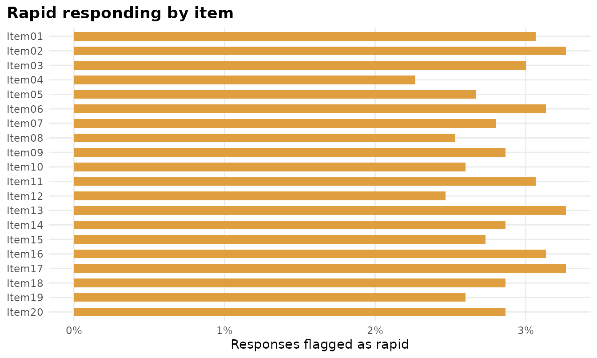
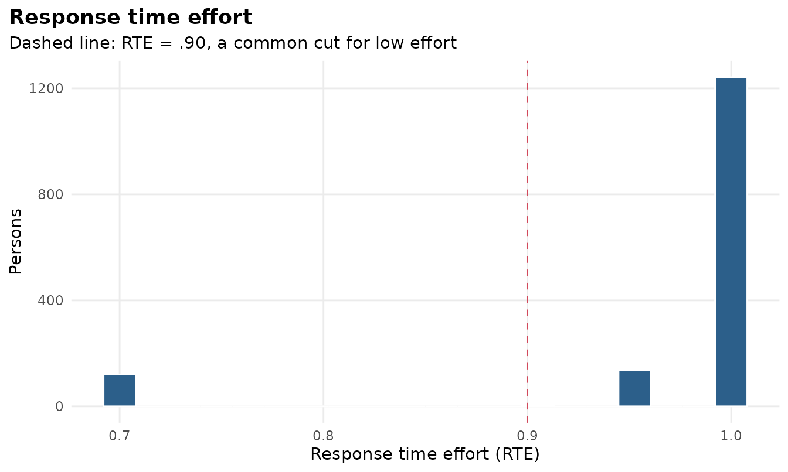
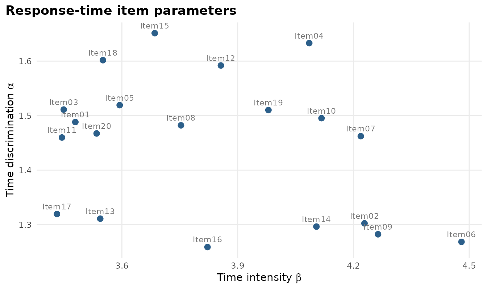
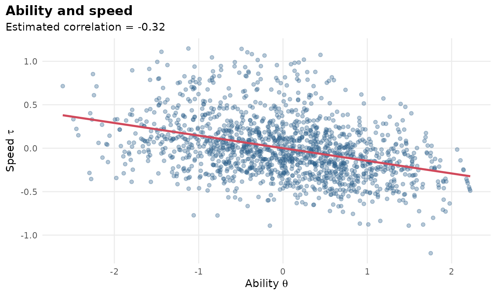

# Response times and rapid guessing

Computer-based tests record how long each response took. mirtverse uses
those times together with a fitted mirt model, following van der
Linden’s (2007) hierarchical framework:

- **Time intensity** ($`\beta_j`$): how long item *j* takes on average
  (log scale).
- **Time discrimination** ($`\alpha_j`$): how consistently the item’s
  times reflect a person’s speed.
- **Speed** ($`\tau_i`$): how fast person *i* works, correlated with
  ability $`\theta_i`$.

``` r

library(mirtverse)
```

## Simulated example

[`sim_rt()`](https://www.okanbulut.com/mirtverse/reference/sim_rt.md)
generates responses and response times; here 8% of examinees rapid-guess
on some items.

``` r

sim <- sim_rt(N = 1500, J = 20, rho = -0.3, rapid = 0.08, seed = 2026)
mod <- mirt(sim$responses, 1, verbose = FALSE)
fit <- fit_rt(mod, sim$rt)
fit
#> Joint model for responses and response times (van der Linden, 2007)
#> 1500 persons, 20 items; converged after 7 iterations; logLik = -50396.33
#> 
#> Speed SD = 0.375 (SE 0.010); ability-speed correlation = -0.325 (SE 0.031)
#> 
#>    item  beta se_beta alpha se_alpha prop_rapid
#>  Item01 3.479   0.023 1.488    0.026      0.031
#>  Item02 4.229   0.026 1.302    0.022      0.033
#>  Item03 3.449   0.023 1.511    0.026      0.030
#>  Item04 4.085   0.023 1.633    0.026      0.023
#>  Item05 3.594   0.023 1.519    0.028      0.027
#>  Item06 4.480   0.026 1.268    0.020      0.031
#>  Item07 4.219   0.024 1.462    0.023      0.028
#>  Item08 3.753   0.024 1.482    0.024      0.025
#>  Item09 4.264   0.025 1.282    0.022      0.029
#>  Item10 4.117   0.024 1.495    0.024      0.026
#>  Item11 3.445   0.023 1.460    0.026      0.031
#>  Item12 3.856   0.023 1.592    0.027      0.025
#>  Item13 3.544   0.024 1.311    0.025      0.033
#>  Item14 4.104   0.025 1.296    0.022      0.029
#>  Item15 3.685   0.024 1.651    0.027      0.027
#>  Item16 3.822   0.025 1.259    0.023      0.031
#>  Item17 3.432   0.024 1.319    0.026      0.033
#>  Item18 3.551   0.022 1.602    0.029      0.029
#>  Item19 3.980   0.024 1.510    0.024      0.026
#>  Item20 3.535   0.023 1.467    0.026      0.029
#> 
#> Rapid responses (residual): 2.9% overall; mean response time effort = 0.971
```

``` r

interpret(fit)
#> Overview
#> --------
#> * Response times for 1500 persons on 20 items were modelled with the
#>   lognormal model, jointly with the fitted IRT model. 
#> 
#> Speed and ability
#> -----------------
#> * The correlation between ability and speed is -0.32 (SE 0.03):
#>   higher-ability examinees tended to work more slowly (more carefully). The
#>   speed SD is 0.37 on the log-time scale. 
#> 
#> Items
#> -----
#> * The most time-intensive item is Item06 (median 95.0 s); the least is Item17
#>   (median 33.0 s). 
#> 
#> Rapid responding
#> ----------------
#> * 2.9% of responses were flagged as rapid (residual method); 8.0% of
#>   examinees have response time effort below .90. 
#> * Consider filtering low-effort examinees (motivation filtering) or
#>   down-weighting rapid responses before reporting scores. 
#> 
#> Person fit
#> ----------
#> * 8.0% of examinees have aberrant overall timing (l_t p < .05), against 5%
#>   expected by chance.
```

## Rapid guessing

Two rules are available. The default `"residual"` rule flags a response
that is much faster than expected for that person on that item. The
`"nt10"` rule flags responses faster than 10% of the item’s mean time
(Wise & Ma, 2012).

``` r

mean(fit$flags[sim$rapid])   # share of simulated rapid guesses detected
#> [1] 1
mean(fit$flags[!sim$rapid])  # false alarms
#> [1] 0.004781421
```

``` r

autoplot(fit, "rapid")
```



``` r

autoplot(fit, "rte")
```



Response time effort (RTE) is each examinee’s share of non-rapid
responses (Wise & Kong, 2005). Examinees below .90 are often excluded
before reporting group results (motivation filtering).

``` r

persons <- augment(fit)
head(persons)
#> # A tibble: 6 × 9
#>    theta se_theta theta_responses_only     tau se_tau  n_rt   rte     lt
#>    <dbl>    <dbl>                <dbl>   <dbl>  <dbl> <dbl> <dbl>  <dbl>
#> 1  0.268    0.406                0.169 -0.643   0.142    20   1    14.4 
#> 2  0.689    0.425                0.674 -0.173   0.142    20   1     6.43
#> 3  1.44     0.491                1.47  -0.0689  0.142    20   1    13.0 
#> 4 -0.989    0.426               -0.870  0.795   0.142    20   0.7 101.  
#> 5  0.807    0.433                0.747 -0.431   0.142    20   1     9.56
#> 6 -0.658    0.410               -0.675 -0.0207  0.142    20   1     4.93
#> # ℹ 1 more variable: lt_p <dbl>
```

## Item parameters and the ability-speed relation

``` r

tidy(fit)
#> # A tibble: 42 × 5
#>    component item   term                  estimate std.error
#>    <chr>     <chr>  <chr>                    <dbl>     <dbl>
#>  1 item      Item01 beta (time intensity)     3.48    0.0234
#>  2 item      Item02 beta (time intensity)     4.23    0.0261
#>  3 item      Item03 beta (time intensity)     3.45    0.0232
#>  4 item      Item04 beta (time intensity)     4.09    0.0227
#>  5 item      Item05 beta (time intensity)     3.59    0.0233
#>  6 item      Item06 beta (time intensity)     4.48    0.0258
#>  7 item      Item07 beta (time intensity)     4.22    0.0243
#>  8 item      Item08 beta (time intensity)     3.75    0.0241
#>  9 item      Item09 beta (time intensity)     4.26    0.0254
#> 10 item      Item10 beta (time intensity)     4.12    0.0236
#> # ℹ 32 more rows
autoplot(fit, "items")
```



``` r

autoplot(fit, "persons")
```



## Notes

The item response parameters are taken from the mirt model and held
fixed; the response-time parameters, speed variance and ability-speed
correlation are estimated by marginal maximum likelihood. Because times
act as collateral information, the joint ability estimates (`theta`) can
be slightly more precise than the response-only estimates
(`theta_responses_only`) when ability and speed are strongly correlated.

## References

van der Linden, W. J. (2007). A hierarchical framework for modeling
speed and accuracy on test items. *Psychometrika, 72*, 287-308.

Wise, S. L., & Kong, X. (2005). Response time effort: A new measure of
examinee motivation in computer-based tests. *Applied Measurement in
Education, 18*, 163-183.
