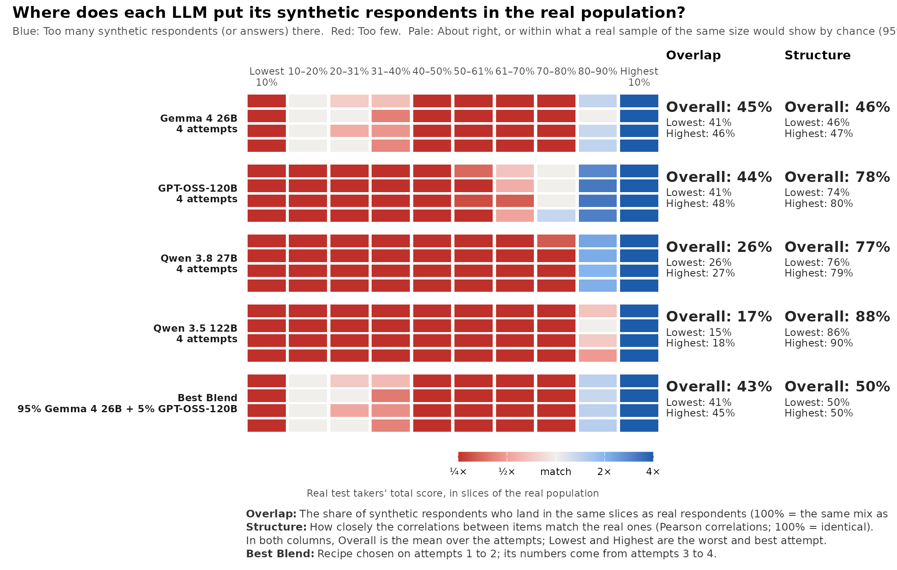
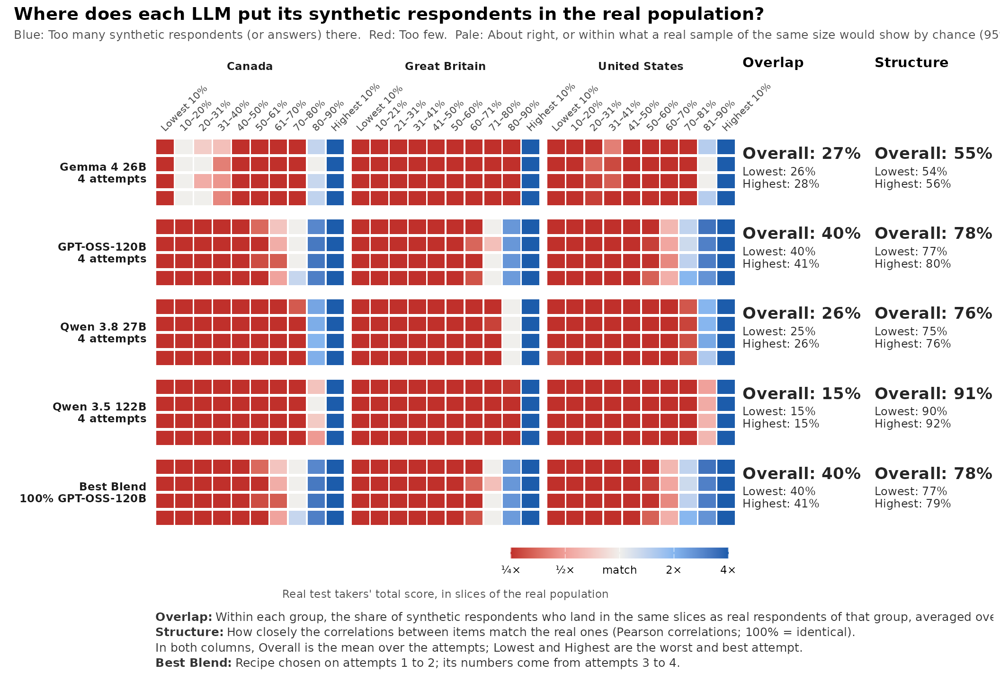
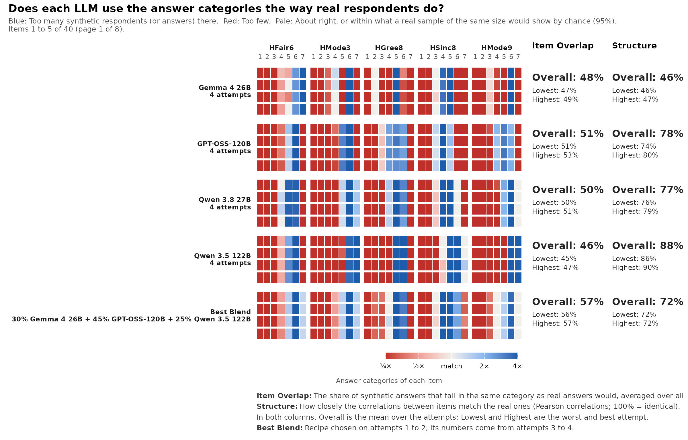

# Checking synthetic respondents: The coverage strip

Large language models can answer questionnaire items as if they were a
person. Before such synthetic respondents are used for anything
(piloting items, checking a scale, or simply judging whether a model
“behaves like people”), it helps to see **where they land in the real
population**. Means and correlations can look fine while most of the
real population is missing from the synthetic sample.

The coverage strip in mirtverse shows this in one picture.
[`synthetic_coverage()`](https://www.okanbulut.com/mirtverse/reference/synthetic_coverage.md)
compares synthetic answers with real answers to the same items, and
[`gg_coverage()`](https://www.okanbulut.com/mirtverse/reference/gg_coverage.md)
draws the strip. The functions are **experimental**: Their arguments may
still change.

## The example data

mirtverse ships the data of a study of synthetic HEXACO respondents:

- `hexaco_real`: 17,874 real people from Canada, Great Britain and the
  United States who answered the 240 IPIP-HEXACO items (Open-Source
  Psychometrics Project).
- `hexaco_llm`: 59,611 synthetic respondents to the same items from four
  open-weight language models (Gemma 4 26B, GPT-OSS-120B, Qwen 3.8 27B
  and Qwen 3.5 122B), generated for the same three countries in 10
  attempts of about 500 respondents each.
- `hexaco_items`: the items, their trait and facet, and whether they are
  reverse-keyed.

Answers are on a 1 to 7 scale and are stored as given, so reverse-keyed
items must be reversed before scores are formed. To keep the example
small, we use the 40 Honesty-Humility items, Canada only, and the first
four attempts of each model.

``` r

library(mirtverse)

h <- hexaco_items$item[hexaco_items$trait == "H"]          # 40 items
rev_items <- intersect(h, hexaco_items$item[hexaco_items$reverse])
keyed <- function(d) {                                     # reverse-key
  d <- d[h]
  d[rev_items] <- 8 - d[rev_items]
  d
}

real <- keyed(hexaco_real[hexaco_real$country == "Canada", ])
ca <- hexaco_llm[hexaco_llm$country == "Canada" & hexaco_llm$attempt <= 4, ]
synthetic <- lapply(split(ca, ca$model), function(m) lapply(split(m, m$attempt), keyed))
str(synthetic, max.level = 1)
#> List of 4
#>  $ Gemma 4 26B  :List of 4
#>  $ GPT-OSS-120B :List of 4
#>  $ Qwen 3.8 27B :List of 4
#>  $ Qwen 3.5 122B:List of 4
```

[`synthetic_coverage()`](https://www.okanbulut.com/mirtverse/reference/synthetic_coverage.md)
takes a **named list with one element per model**, and each element is a
list of attempts (data frames with the same items as the real data).
Your own synthetic data do not have to come from mirtverse; any data
frames in this shape work.

## Drawing the strip

``` r

cov <- synthetic_coverage(synthetic, real, cor = "pearson")
cov
#> <mv_coverage> 4 model(s), 40 item(s), coverage of real total-score slices (EXPERIMENTAL)
#>          model attempts overlap_overall overlap_lowest overlap_highest
#>    Gemma 4 26B        4             45%            41%             46%
#>   GPT-OSS-120B        4             44%            41%             48%
#>   Qwen 3.8 27B        4             26%            26%             27%
#>  Qwen 3.5 122B        4             17%            15%             18%
#>     Best Blend        2             43%            41%             45%
#>  structure_overall structure_lowest structure_highest
#>                46%              46%               47%
#>                78%              74%               80%
#>                77%              76%               79%
#>                88%              86%               90%
#>                50%              50%               50%
#> 
#> Best Blend: 95% Gemma 4 26B + 5% GPT-OSS-120B (chosen on attempts 1 to 2; its numbers come from attempts 3 to 4)
#> 
#> * 1 real respondent(s) with missing answers are left out of the score
#>   slices.
```

``` r

gg_coverage(cov)
```



### How to read it

- **Columns** are slices of the real population. By default they are
  deciles of the real total score: Each column holds 10% of the real
  respondents, from the lowest 10% on the left to the highest 10% on the
  right.
- **Rows** are attempts. Each block of rows is one model, and each row
  is one attempt, so you can see at once whether a pattern repeats.
- **Colour** compares the share of synthetic respondents in a slice with
  the real share (10%). Blue means too many synthetic respondents there,
  red means too few. Pale means about right, **or** within the range a
  real sample of the same size would show by chance (95%). That noise
  check keeps a 500-person attempt from looking worse than it is.
- **Overlap** is the share of synthetic respondents who land where real
  respondents do: The sum over slices of the smaller of the two shares.
  100% means the same mix of slices as the real population; a sample
  that puts everyone in one decile scores about 10%.
- **Structure** is how closely the correlations between items match the
  real ones: One minus the mean absolute difference between the real and
  synthetic correlations (100% means identical).
- **Best Blend** is the mixture of models with the highest Overlap. With
  four or more attempts, the recipe is chosen on the first half of the
  attempts and its numbers come from the second half, so a lucky fit to
  noise is not rewarded.

Here every model puts far too many synthetic Canadians in the top decile
of real Honesty-Humility (dark blue on the right) and too few in most
other deciles (red). The rows within each model look alike, so this is
how the models behave, not one bad run. Note also the two columns on the
right: Qwen 3.5 122B has the **best** Structure and the **worst**
Overlap. A model can know which items go together and still put its
respondents in the wrong place, which is why the strip shows both.

## Comparing groups

When the synthetic respondents were generated for groups (countries,
personas, regions), pass the group column with `group`. With
`within_group = TRUE`, slices and shares are taken within each group, so
each group’s synthetic respondents are compared with the real
respondents of the same group, and Overlap is averaged over the groups.

``` r

real3 <- data.frame(country = hexaco_real$country, keyed(hexaco_real))
four <- hexaco_llm[hexaco_llm$attempt <= 4, ]
synthetic3 <- lapply(split(four, four$model), function(m)
  lapply(split(m, m$attempt), function(a) data.frame(country = a$country, keyed(a))))

cov3 <- synthetic_coverage(synthetic3, real3, group = "country",
                           within_group = TRUE, cor = "pearson")
gg_coverage(cov3)
```



Use `within_group = TRUE` whenever the real and synthetic samples have a
different mix of groups. Here the real data are mostly American (15,017
of 17,874) while the synthetic data are split evenly; without
`within_group`, the difference in the mix would colour whole blocks.

## Looking at items

`slices = "item"` changes the columns to the response categories of each
item. The strip then shows which answers the models over-use and which
they avoid, and **Item Overlap** replaces Overlap. With many items, the
strip is paged; `order = "worst"` (the default) puts the items with the
lowest Item Overlap first.

``` r

cov_items <- synthetic_coverage(synthetic, real, slices = "item", cor = "pearson")
gg_coverage(cov_items, items_per_plot = 5)
```



Most items show a few heavily used categories next to nearly empty ones,
and the extreme categories are often red: The models seldom give the
strongest answers that real people often give. This is one reason the
synthetic score distributions are too narrow.

## Tidy output

Every number in the strip is available as data, for tables or your own
plots:

``` r

tidy(cov)            # one row per model: Overlap and Structure
#> # A tibble: 5 × 8
#>   model         attempts overlap_overall overlap_lowest overlap_highest
#>   <chr>            <int>           <dbl>          <dbl>           <dbl>
#> 1 Gemma 4 26B          4           0.446          0.413           0.465
#> 2 GPT-OSS-120B         4           0.437          0.413           0.483
#> 3 Qwen 3.8 27B         4           0.261          0.257           0.270
#> 4 Qwen 3.5 122B        4           0.172          0.150           0.184
#> 5 Best Blend           2           0.430          0.413           0.447
#> # ℹ 3 more variables: structure_overall <dbl>, structure_lowest <dbl>,
#> #   structure_highest <dbl>
head(cov$attempts)   # one row per attempt
#> # A tibble: 6 × 5
#>   model        attempt overlap     n structure
#>   <chr>          <int>   <dbl> <dbl>     <dbl>
#> 1 Gemma 4 26B        1   0.465   500     0.464
#> 2 Gemma 4 26B        2   0.463   500     0.458
#> 3 Gemma 4 26B        3   0.413   500     0.463
#> 4 Gemma 4 26B        4   0.445   500     0.471
#> 5 GPT-OSS-120B       1   0.483   500     0.740
#> 6 GPT-OSS-120B       2   0.423   500     0.800
cov$blend$recipe
#> [1] "95% Gemma 4 26B + 5% GPT-OSS-120B"
```

## Tips

- **Reverse-key first.** Score slices use the total score, so
  reverse-keyed items must be reversed (as `keyed()` does above).
- **One construct at a time.** Run the strip per scale or trait; a total
  over unrelated traits is hard to interpret.
- **Use several attempts.** Two attempts show whether a pattern repeats;
  four or more also allow a held-out Best Blend.
- **Pearson or polychoric.** `cor = "auto"` uses polychoric correlations
  for ordered items. When synthetic respondents leave some categories
  nearly empty, as here, polychoric correlations become unstable and
  `cor = "pearson"` is the safer choice.
- **`slices = "theta"`** uses deciles of an IRT trait estimate instead
  of the total score, and `slices = "group"` compares only the mix of
  groups.

## Learn more

- [`?synthetic_coverage`](https://www.okanbulut.com/mirtverse/reference/synthetic_coverage.md),
  [`?gg_coverage`](https://www.okanbulut.com/mirtverse/reference/gg_coverage.md),
  [`?blend_llms`](https://www.okanbulut.com/mirtverse/reference/blend_llms.md),
  and the dataset pages
  [`?hexaco_real`](https://www.okanbulut.com/mirtverse/reference/hexaco_real.md),
  [`?hexaco_llm`](https://www.okanbulut.com/mirtverse/reference/hexaco_llm.md)
  and
  [`?hexaco_items`](https://www.okanbulut.com/mirtverse/reference/hexaco_items.md).
- [`simulate_llm_respondents()`](https://www.okanbulut.com/mirtverse/reference/simulate_llm_respondents.md)
  and
  [`compare_synthetic()`](https://www.okanbulut.com/mirtverse/reference/compare_synthetic.md)
  in the [AI
  Hub](https://www.okanbulut.com/mirtverse/articles/ai-hub.md) generate
  and check synthetic respondents for your own items.
- The [reading
  list](https://www.okanbulut.com/mirtverse/articles/ai-reading.html#synthetic-respondents)
  collects papers on language models as respondents.
