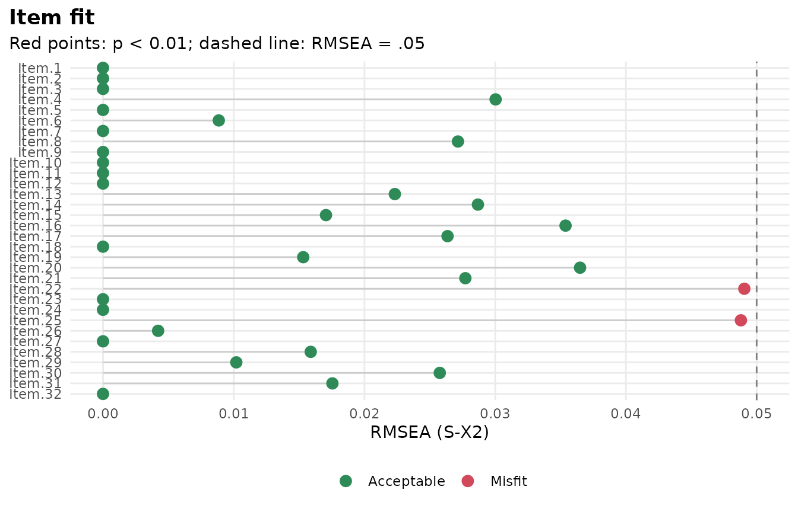
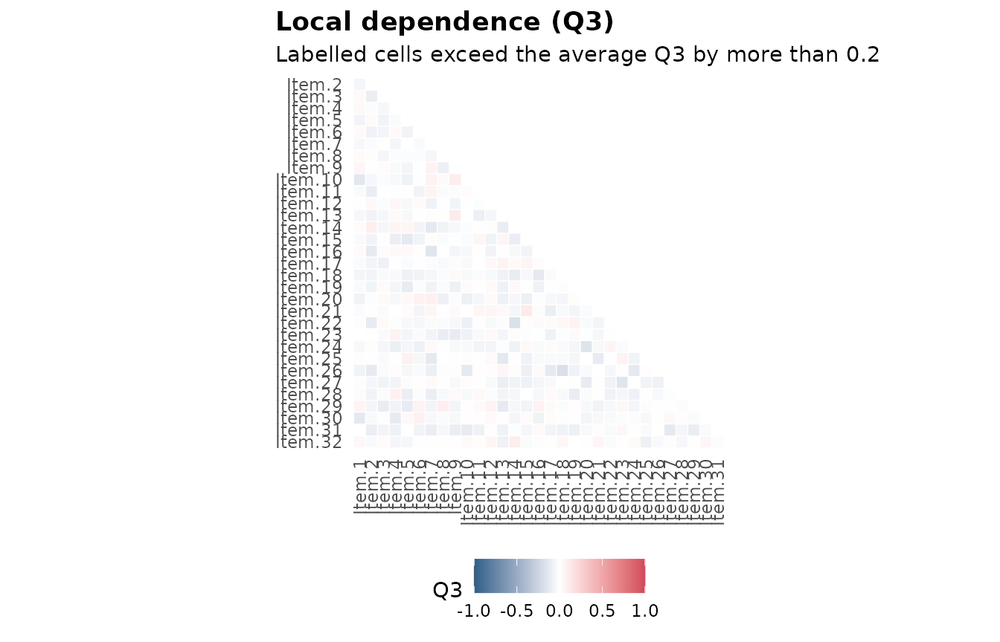
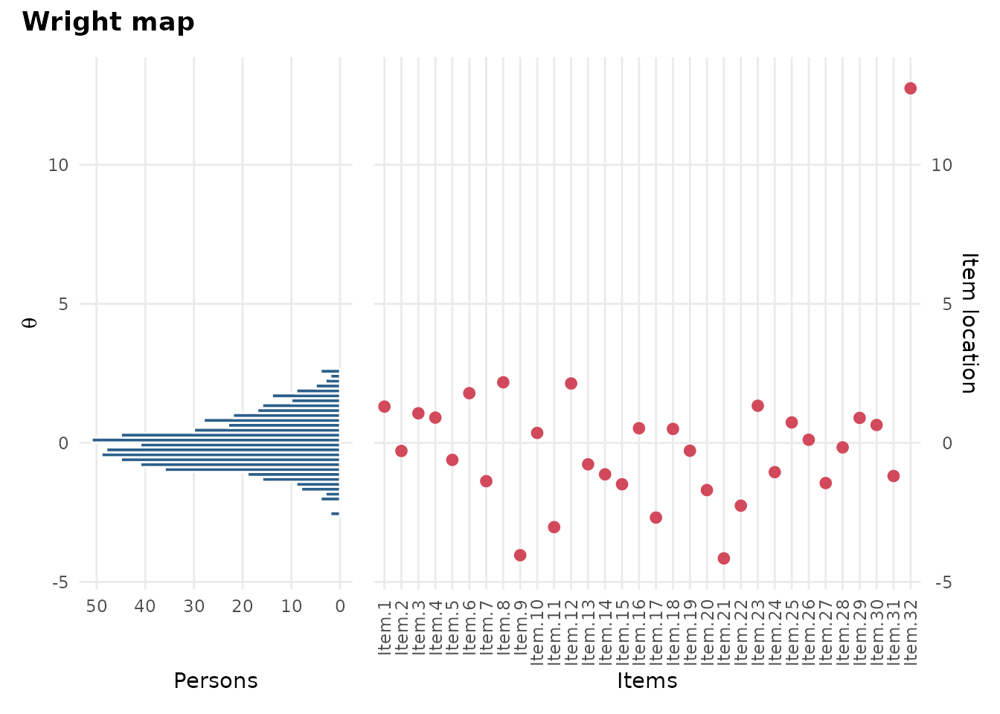
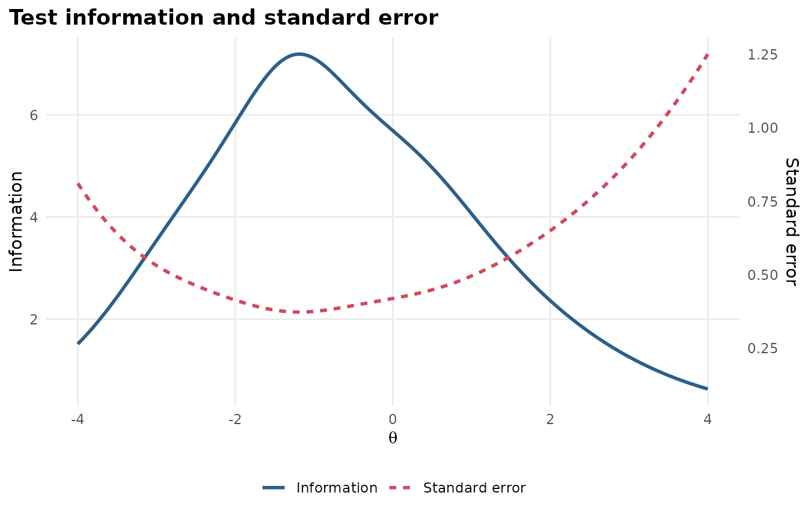

# Thesis kit: From item responses to a Methods section

A thesis committee wants three things from an IRT analysis: That the
model was chosen for a reason, that it was checked, and that the
write-up says exactly what was done. This kit walks through all three
with one dataset, and ends with a Methods paragraph and reference list
you can paste into your thesis and then edit.

The example uses `SAT12`, a 32-item science test taken by 600 students,
which comes with mirt. Swap in your own data at step 1 and run the rest
as it is.

## The checklist

Keep this list next to your draft. Each step below covers one line.

Describe the data and run a classical item analysis.

Compare at least two IRT models and say why you chose one.

Check dimensionality, local independence and item fit.

Report overall fit (M2 or C2 with RMSEA, SRMSR and CFI) and reliability.

Make the figures: A Wright map and test information at minimum.

Write the Methods paragraph and cite mirt and mirtverse.

Save the code and an HTML report as an appendix.

## 1. Describe the data

``` r

library(mirtverse)

key <- c(1,4,5,2,3,1,2,1,3,1,2,4,2,1,5,3,4,4,1,4,3,3,4,1,3,5,1,3,1,5,4,5)
data <- key2binary(SAT12, key)       # score multiple-choice answers 0/1
dim(data)
#> [1] 600  32
```

``` r

head(itemstats(data)$itemstats)       # classical item statistics
#>          N K  mean    sd cor_if_rm   smc alpha_if_rm
#> Item.1 600 2 0.283 0.451     0.300 0.158       0.793
#> Item.2 600 2 0.568 0.496     0.464 0.270       0.785
#> Item.3 600 2 0.280 0.449     0.371 0.184       0.789
#> Item.4 600 2 0.378 0.485     0.235 0.145       0.796
#> Item.5 600 2 0.620 0.486     0.340 0.197       0.791
#> Item.6 600 2 0.160 0.367     0.351 0.185       0.791
```

Look for items that almost everyone gets right or wrong, and for items
with a low or negative item-total correlation: They are often miskeyed.
If you remove an item, write down why;
[`cite_methods()`](https://www.okanbulut.com/mirtverse/reference/cite_methods.md)
can report it (step 5).

## 2. Choose a model

[`select_model()`](https://www.okanbulut.com/mirtverse/reference/select_model.md)
fits the candidate models to the same data, compares them, and explains
its choice in plain language. Quote that reasoning in your thesis rather
than just the winner.

``` r

sel <- select_model(data, candidates = c("Rasch", "2PL"), verbose = FALSE)
sel
#> mirtverse model selection (ranked by BIC)
#> 
#>  model npar    logLik      AIC      BIC    SABIC RMSEA   CFI   delta weight
#>    2PL   64 -9488.955 19105.91 19387.31 19184.13 0.028 0.953   0.000      1
#>  Rasch   33 -9643.469 19352.94 19498.04 19393.27 0.041 0.894 110.724      0
#> 
#> The 2PL model is recommended because it has the lowest BIC (19387.3). The
#> runner-up, Rasch, is 110.7 BIC points worse, which is very strong evidence for
#> the 2PL model. Likelihood-ratio test Rasch vs. 2PL: chi-square(31) = 309.03, p
#> < .001; the 2PL model fits significantly better. Absolute fit of the 2PL model:
#> RMSEA = 0.028 (close fit), CFI = 0.953, SRMSR = 0.045.
mod <- sel$best
```

## 3. Check the model

Three checks most committees ask about: Overall fit, item fit and local
dependence.

``` r

glance(mod)[, c("M2", "df", "p.value", "RMSEA", "SRMSR", "CFI", "reliability")]
#> # A tibble: 1 × 7
#>      M2    df  p.value  RMSEA  SRMSR   CFI reliability
#>   <dbl> <int>    <dbl>  <dbl>  <dbl> <dbl>       <dbl>
#> 1  684.   464 1.15e-10 0.0281 0.0452 0.953       0.836
```

``` r

gg_itemfit(mod)
```



``` r

gg_q3(mod)
```



`interpret(mod)` writes a plain-language summary of these results, which
is a good check on your own reading of them.

## 4. Make the figures

Every plot is a ggplot2 object. Save figures at the size of your page,
at 300 dpi, so the text in them matches the text around them.

``` r

p <- gg_wright(mod)
p
```



``` r

gg_info(mod)
```



``` r

ggplot2::ggsave("figure-1-wright-map.png", p, width = 6.5, height = 4.5, dpi = 300)
```

For an item-by-item table in the results chapter, `item_table(mod)` has
the item statistics, fit and flags in one data frame. Write it to a CSV
file and paste it into Word as a table:

``` r

write.csv(item_table(mod), "table-2-items.csv", row.names = FALSE)
```

## 5. Write the Methods paragraph

[`cite_methods()`](https://www.okanbulut.com/mirtverse/reference/cite_methods.md)
drafts the software, model, estimation, model choice, fit and
reliability sentences, in APA style, with the references they cite. Give
it the
[`select_model()`](https://www.okanbulut.com/mirtverse/reference/select_model.md)
result so it describes the comparison too.

``` r

cite_methods(sel, sample = "high school students",
             items = "multiple-choice science items")
#> Analyses were conducted in R (version 4.6.2; R Core Team, 2026) with
#> the mirt package (version 1.48; Chalmers, 2012) for item response
#> theory (IRT) and the mirtverse package (version 0.2.0; Bulut, 2026) for
#> model comparison, fit summaries and reporting.
#> 
#> A unidimensional two-parameter logistic (2PL) model (Birnbaum, 1968)
#> was fitted to the responses of 600 high school students to 32
#> dichotomously scored multiple-choice science items, using marginal
#> maximum likelihood with the expectation-maximization (EM) algorithm
#> (Bock & Aitkin, 1981).
#> 
#> To choose the model, the Rasch and 2PL models were compared on the
#> Bayesian information criterion (Schwarz, 1978); the 2PL model had the
#> lowest value (BIC = 19387.3, compared with 19498.0 for the Rasch).
#> Likelihood-ratio tests between nested models gave χ²(31) = 309.03, p <
#> .001 for the 2PL against the Rasch.
#> 
#> Overall model fit was evaluated with the limited-information M2
#> statistic (Maydeu-Olivares & Joe, 2006): M2(464) = 683.96, p < .001,
#> RMSEA = .028, SRMSR = .045, CFI = .953. Item fit was examined with the
#> S-X² statistic (Orlando & Thissen, 2000); 2 of the 32 items (Item.22
#> and Item.25) showed misfit at α = .01. Marginal reliability was .84.
#> 
#> References
#> 
#> Birnbaum, A. (1968). Some latent trait models and their use in
#>     inferring an examinee's ability. In F. M. Lord & M. R. Novick
#>     (Eds.), *Statistical theories of mental test scores* (pp. 397–479).
#>     Addison-Wesley.
#> Bock, R. D., & Aitkin, M. (1981). Marginal maximum likelihood
#>     estimation of item parameters: Application of an EM algorithm.
#>     *Psychometrika, 46*(4), 443–459. https://doi.org/10.1007/BF02293801
#> Bulut, O. (2026). *mirtverse: A friendly workflow and reporting layer
#>     for 'mirt'* (Version 0.2.0) [R package]. Zenodo.
#>     https://doi.org/10.5281/zenodo.23719384
#> Chalmers, R. P. (2012). mirt: A multidimensional item response theory
#>     package for the R environment. *Journal of Statistical Software,
#>     48*(6), 1–29. https://doi.org/10.18637/jss.v048.i06
#> Maydeu-Olivares, A., & Joe, H. (2006). Limited information
#>     goodness-of-fit testing in multidimensional contingency tables.
#>     *Psychometrika, 71*(4), 713–732.
#>     https://doi.org/10.1007/s11336-005-1295-9
#> Orlando, M., & Thissen, D. (2000). Likelihood-based item-fit indices
#>     for dichotomous item response theory models. *Applied Psychological
#>     Measurement, 24*(1), 50–64.
#>     https://doi.org/10.1177/01466216000241003
#> R Core Team. (2026). *R: A language and environment for statistical
#>     computing*. R Foundation for Statistical Computing.
#>     https://www.R-project.org/
#> Schwarz, G. (1978). Estimating the dimension of a model. *The Annals of
#>     Statistics, 6*(2), 461–464. https://doi.org/10.1214/aos/1176344136
#> 
#> Check the text against your analysis before you use it.
```

To get a Word file with the paragraph and the references:

``` r

cite_methods(sel, sample = "high school students",
             items = "multiple-choice science items",
             file = "methods.docx")
```

Treat the text as a first draft. Read it against your analysis, add what
only you know (how the data were collected, ethics approval, why the
test was given), and rewrite it in your own voice. Your committee will
read it as yours.

## 6. Keep an appendix

One HTML file holds the whole analysis: Model comparison, parameters,
fit, figures and item health cards.

``` r

mv_report(sel, file = "appendix-irt-analysis.html")
```

Save your R script next to it. If someone asks how a number was
produced, the script answers.

## Where to go next

- [The book](https://www.okanbulut.com/mirtverse/book/index.md) explains
  each step in more depth: See the chapters on [estimation and comparing
  models](https://www.okanbulut.com/mirtverse/book/estimation.md),
  [fit](https://www.okanbulut.com/mirtverse/book/fit.md) and
  [reporting](https://www.okanbulut.com/mirtverse/book/reporting.md).
- [Differential item
  functioning](https://www.okanbulut.com/mirtverse/reference/dif.md) if
  your thesis compares groups.
- [Gallery](https://www.okanbulut.com/mirtverse/articles/gallery.md) for
  every figure type.
