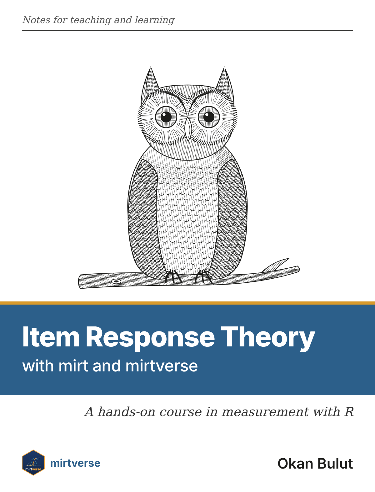

# Preface {-}

```{r cover, echo = FALSE, include = knitr::is_html_output(excludes = "epub"), out.width = "260px", fig.alt = "Book cover: an engraved owl on a branch above the title Item Response Theory with mirt and mirtverse", out.extra = 'style="float: right; margin: 0 0 1em 1.5em; box-shadow: 0 2px 8px rgba(0,0,0,.25);"'}

```

This book is a set of extended course notes on item response theory (IRT). It
is written for instructors who teach measurement with R and for the students
in their courses. Every chapter mixes a short explanation of the ideas with
worked examples that you can run line by line, using the
[mirt](https://philchalmers.github.io/mirt/) package [@chalmers2012] for
estimation and [mirtverse](https://www.okanbulut.com/mirtverse/) for model
choice, tidy tables, graphics and plain-language interpretation.

## How the book is organised {-}

The twelve chapters follow the twelve weeks of the mirtverse [course
map](https://www.okanbulut.com/mirtverse/articles/course-map.html), so an
instructor can assign one chapter a week and pair it with the matching lab.

| Chapter | Topic | Matching lab |
|---|---|---|
| \@ref(measurement) | Measurement, scoring and classical item analysis | Lab 1 (first two sections) |
| \@ref(irt-models) | The Rasch, 2PL and 3PL models | |
| \@ref(estimation) | Estimation and comparing models | |
| \@ref(dimensionality) | Dimensionality and local independence | Lab 1 |
| \@ref(fit) | Item fit, person fit and item quality | |
| \@ref(information) | Information, precision and reliability | |
| \@ref(scoring) | Scoring people | Lab 2 |
| \@ref(polytomous) | Polytomous items and open-ended responses | Lab 6 |
| \@ref(dif) | Differential item functioning and fairness | Lab 3 |
| \@ref(linking) | Linking and equating | Lab 4 |
| \@ref(banks-cat) | Item banks, test assembly and adaptive testing | Lab 5 |
| \@ref(reporting) | Cut scores, reporting and communicating results | Final project |

Table: (\#tab:chapters) The twelve chapters and their matching labs.

A second part, *AI in measurement*, is for readers who know IRT and want to
learn how machine learning and large language models fit into
psychometrics. It goes with the mirtverse [AI
Hub](https://www.okanbulut.com/mirtverse/articles/ai-hub.html) and grows as
the hub does.

| Chapter | Topic | Matching lab |
|---|---|---|
| \@ref(ml-lens) | Machine learning through an IRT lens | |
| \@ref(item-text) | What item text tells us | Lab 8 |
| \@ref(aig) | Generating items | Lab 9 |
| \@ref(auto-scoring) | Automated scoring | Lab 7 |
| \@ref(llms) | Large language models as a colleague | |
| \@ref(ai-validity) | Validity, fairness and governance of AI | Lab 10 |

Table: (\#tab:ai-chapters) The chapters on AI in measurement.

A third part, *Knowledge graphs*, describes what a test measures as a graph
of concepts, prerequisites and items, and turns the graph into IRT models.
Chapter \@ref(knowledge-graphs) builds and checks the graphs, and Chapter
\@ref(knowledge-tracing) follows students' mastery of the concepts over
time with knowledge tracing.

Every chapter has the same parts:

* **Learning goals:** What you should be able to do after the chapter.
* **Key terms:** Links to the mirtverse
  [glossary](https://www.okanbulut.com/mirtverse/articles/glossary.html).
* **The ideas:** A short explanation, with formulas only where they help.
* **Example 1 and Example 2:** Two worked analyses on different data, so you
  see the same method in two settings.
* **Your turn:** Exercises with solutions. In the online edition the
  solutions are folded away; click to open them.
* **In the lab:** The interactive mirtverse lab that goes with the chapter.
* **Further reading.**

The examples deliberately use different data from the labs. The labs hide
problems in their data for students to find, and the book does not give those
away.

## Before you start {-}

You need R (version 4.1 or later), mirt (version 1.48 or later) and mirtverse:

```{r, eval = FALSE}
install.packages(c("mirt", "learnr"))
install.packages("mirtverse", repos = c("https://okanbulut.r-universe.dev",
                                        "https://cloud.r-project.org"))
library(mirtverse)
```

Loading mirtverse also loads mirt, so `mirt()`, `fscores()`, `itemfit()` and
the mirt datasets are available straight away. Every example runs in a few
seconds on a laptop, and no internet connection is needed once the packages
are installed.

Students who are new to R can follow much of the book without writing code.
The [workbench](https://www.okanbulut.com/mirtverse/articles/workbench.html)
(`launch_workbench()`) runs the same analyses by pointing and clicking and
shows the R code for every step, and
[`mv_ask()`](https://www.okanbulut.com/mirtverse/articles/mv-ask-guide.html)
writes a script from a plain-language request.

## Other teaching materials {-}

* [Teaching labs](https://www.okanbulut.com/mirtverse/articles/teaching-labs.html):
  Ten interactive learnr labs with an instructor guide and answer key.
* [Course map](https://www.okanbulut.com/mirtverse/articles/course-map.html):
  A 12-week syllabus with readings, functions, labs and assessment ideas.
* [Glossary](https://www.okanbulut.com/mirtverse/articles/glossary.html) of
  IRT terms.
* [Cheat sheet](https://www.okanbulut.com/mirtverse/cheatsheet/mirtverse-cheatsheet.pdf)
  of the main functions, on two printable pages.
* [Assessment pipeline](https://www.okanbulut.com/mirtverse/articles/assessment-pipeline.html):
  A test's full life cycle from blueprint to bank monitoring.

## Using and adapting the book {-}

The source of every chapter is an R Markdown file in the
[`book/` folder](https://github.com/okanbulut/mirtverse/tree/main/book) of the
mirtverse repository. Each example loads its data in one clearly labelled
chunk, so you can swap in your own data and rebuild the chapter. Appendix
\@ref(adapting) explains how.

## Other formats {-}

The book is free to read online at <https://www.okanbulut.com/mirtverse/book/>.
It is also available as a
[PDF](https://www.okanbulut.com/mirtverse/book/mirtverse-book.pdf) for
printing and an
[EPUB](https://www.okanbulut.com/mirtverse/book/mirtverse-book.epub) for
e-readers; in the online edition, use the download button in the toolbar.
All three are built from the same source each time the book changes.

## How to cite this book {-}

If you use the book in a course or in your work, please cite it as:

> Bulut, O. (2026). *Item response theory with mirt and mirtverse: Notes for
> teaching and learning*. Zenodo. https://doi.org/10.5281/zenodo.23885605

<a href="https://doi.org/10.5281/zenodo.23885605"></a>

The DOI above always points to the latest edition of the book. Each archived
edition also has its own DOI, listed on the
[Zenodo record](https://doi.org/10.5281/zenodo.23885605); cite that one if you need to
refer to the exact text you read (version 1.0 is
[10.5281/zenodo.23885606](https://doi.org/10.5281/zenodo.23885606)).

```bibtex
@book{bulut2026irt,
  author    = {Okan Bulut},
  title     = {Item Response Theory with mirt and mirtverse: Notes for Teaching and Learning},
  year      = {2026},
  publisher = {Zenodo},
  doi       = {10.5281/zenodo.23885605},
  url       = {https://www.okanbulut.com/mirtverse/book/}
}
```

Please also cite the software you use: mirt [@chalmers2012] and mirtverse
(`citation("mirtverse")` gives the reference with its DOI).

## Licence {-}

© 2026 Okan Bulut. The text and figures of this book are licensed under a
[Creative Commons Attribution-NonCommercial-ShareAlike 4.0 International
licence](https://creativecommons.org/licenses/by-nc-sa/4.0/) (CC BY-NC-SA
4.0): You may share and adapt them for non-commercial purposes, such as
teaching, as long as you give credit and share your adaptations under the
same licence. The R code in the book is licensed under GPL-3, like
mirtverse, so you can reuse it freely in your own analyses.

## Acknowledgements {-}

This book stands on the work of many people. Phil Chalmers wrote and
maintains mirt, which does all of the estimation in these pages. The book
was written with R Markdown and bookdown, by Yihui Xie and colleagues, and
the figures were drawn with ggplot2. My thanks to all of them, and to the
R community that makes open teaching materials like this possible.
