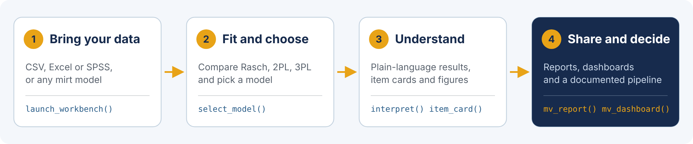
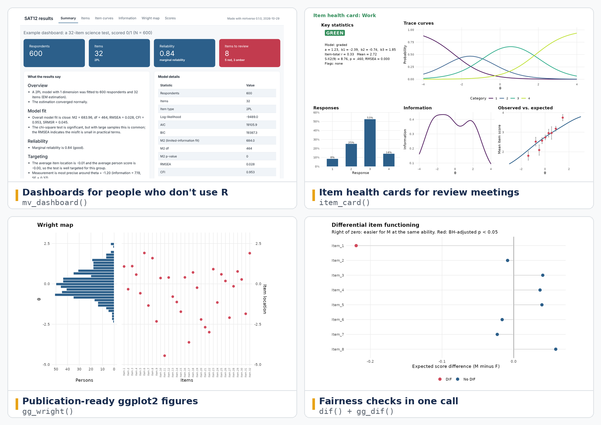

# Summary

Item response theory (IRT) is the statistical foundation of most modern
tests: It links the responses people give to test items with the latent
trait the test is meant to measure, and it underpins item banking, test
assembly, computerized adaptive testing, score linking and fairness analyses
[@lord1980; @embretson2000; @deayala2022]. The R environment [@rcore] offers
many IRT packages, and among them **mirt** [@chalmers2012] stands out for
the breadth of models and estimation methods it supports. Its power comes
with a cost, however: Choosing, checking, interpreting and reporting a model
in mirt requires fluency in both R and psychometrics.

**mirtverse** [@mirtverse] is an R package that sits on top of mirt and
makes it usable by a wider audience. It turns fitted mirt models into tidy
tables, publication-ready ggplot2 graphics [@wickham2016], plain-language
interpretations, item health cards, one-file HTML reports and shareable
dashboards. A point-and-click Shiny workbench runs the same functions and
writes the R code for every step. Beyond the usual IRT toolkit, mirtverse adds
a generative AI layer that writes analysis scripts from a plain-language
request, drafts and verifies test items, trains and audits automated scorers
for open-ended responses, and predicts item difficulty from item text. Every
AI feature sits behind a psychometric check, so a language model can speed
up the work but cannot quietly lower its standards. The package is
accompanied by an open textbook [@bulutbook2026], ten interactive teaching
labs and an instructor toolkit.

This paper reviews the theory that mirtverse builds on, the current landscape
of IRT software in R, the reasons for building on mirt, and the design of
mirtverse, including its AI capabilities.

# Statement of need

IRT is taught in graduate programs in education, psychology and the health
sciences, and it is used every day by testing organizations, credentialing
bodies and researchers who build questionnaires. Yet the people who need IRT
results are often not the people who can produce them. Three gaps stand out.

1. **The skills gap.** Fitting a model is one line of code in most packages,
   but the analysis around it is not: Comparing candidate models, checking
   dimensionality, local independence and item fit, interpreting
   parameters, and reporting the results in a form that a committee, a
   content team or a policy maker can use. Students and practitioners who
   are new to R often stall at this stage, and many fall back on commercial
   point-and-click programs that hide the analysis behind menus.
2. **The reporting gap.** Psychometric output is designed for
   psychometricians. Item reviewers, teachers and test sponsors need
   summaries, flags and figures rather than parameter tables, and
   assembling those by hand is slow and error-prone.
3. **The AI gap.** Large language models (LLMs) and machine learning now
   generate items, score essays and estimate item properties
   [@hao2024; @bulut2024]. Most psychometricians, however, have no
   practical way to try these methods within their usual workflow, and the
   methods themselves need the same validity and fairness evidence as any
   other part of a test [@aera2014; @williamson2012; @kane2013].

mirtverse addresses all three gaps without replacing the estimation engine
that psychometricians already trust. Every mirtverse result is computed from
an ordinary mirt model object, so analyses remain reproducible, citable and
open to inspection by anyone who knows mirt.

# Background: Item response theory in brief

IRT models the probability of a response as a function of a person's
position on a latent trait, $\theta$, and the characteristics of the item.
For a dichotomously scored item $j$, the three-parameter logistic (3PL)
model [@birnbaum1968] is

$$
P(X_{ij} = 1 \mid \theta_i) = c_j + (1 - c_j)\,
\frac{\exp\{a_j(\theta_i - b_j)\}}{1 + \exp\{a_j(\theta_i - b_j)\}},
$$

where $b_j$ is the item's difficulty, $a_j$ its discrimination and $c_j$ a
lower asymptote that allows for guessing. Fixing $c_j = 0$ gives the
two-parameter logistic (2PL) model, and also constraining all $a_j$ to be
equal gives the Rasch model [@rasch1960], whose sufficient statistics and
specific objectivity have made it popular in educational assessment and
health outcomes measurement. For items scored in more than two ordered
categories, the graded response model [@samejima1969], the partial credit
model [@masters1982] and the generalized partial credit model
[@muraki1992] extend the same logic to category response functions.

Three properties make IRT more useful than classical test theory for many
practical problems [@hambleton1991; @embretson2000]. First, item and person
parameters are placed on a common scale, which supports item banking,
linking and equating across test forms [@kolen2014]. Second, the item
information function, $I_j(\theta)$, shows how precisely each item measures
at each trait level, and the test information
$I(\theta) = \sum_j I_j(\theta)$ gives a conditional standard error,
$SE(\hat\theta) = 1/\sqrt{I(\theta)}$, rather than a single reliability
coefficient for everyone. This is what makes computerized adaptive testing
possible [@wainer2000]. Third, the model makes testable predictions, so its
assumptions can and should be checked.

Item parameters are usually estimated by marginal maximum likelihood with the
expectation-maximization (EM) algorithm [@bock1981], which integrates the
latent trait out of the likelihood; stochastic algorithms such as the
Metropolis-Hastings Robbins-Monro (MH-RM) algorithm [@cai2010] make
high-dimensional and mixed-effects models feasible [@chalmers2015]. Once a
model is fitted, a defensible analysis checks overall fit, for example with
the limited-information $M_2$ statistic and its RMSEA [@maydeu2006]; item fit,
for example with the $S\text{-}X^2$ statistic [@orlando2000]; local
dependence, for example with Yen's $Q_3$ [@yen1984]; and differential item
functioning (DIF) between groups of test takers [@holland1993]. Persons are
then scored, typically by expected a posteriori (EAP) or maximum likelihood
estimation, with standard errors.

Two extensions matter for what follows. Explanatory IRT models
[@deboeck2004] replace or explain item and person parameters with
covariates. The linear logistic test model [@fischer1973], for instance,
expresses item difficulty as a weighted sum of item features, which connects
IRT to the modern task of predicting item difficulty from item text. And
joint models for responses and response times [@vanderlinden2007] use the
time each person spends on each item as a second source of information about
speed, effort and test-taking behaviour.

# State of the field

R has become one of the main platforms for IRT, and several reviews compare
the available packages [@choi2019]. Table 1 summarises widely used packages
and their focus.

: Table 1. Selected R packages for item response theory.

| Package | Focus |
|---|---|
| **ltm** [@rizopoulos2006] | Unidimensional Rasch, 2PL, 3PL, graded and generalized partial credit models by marginal maximum likelihood |
| **eRm** [@mair2007] | The Rasch model family by conditional maximum likelihood, including the linear logistic test model |
| **TAM** [@tam] | Unidimensional and multidimensional Rasch-type and 2PL models, facets models and tools for large-scale assessment |
| **irtQ** [@irtq] | Unidimensional models, fixed item parameter calibration and online calibration for operational testing |
| **mirt** [@chalmers2012] | Unidimensional and multidimensional, exploratory and confirmatory, multiple-group and mixed-effects IRT with many item types and estimators |
| **lme4** approach [@deboeck2011] and **eirm** [@bulut2021] | Rasch-type and explanatory IRT models as generalized linear mixed models |
| **lavaan** [@rosseel2012] | Item factor analysis of categorical indicators within structural equation modeling |
| **difR** [@magis2010] | Detection of differential item functioning with many methods |
| **mirtCAT** [@chalmers2016] | Computerized adaptive and non-adaptive test interfaces built on mirt |
| **ShinyItemAnalysis** [@martinkova2018] | A Shiny application for teaching psychometrics and routine item analysis |

These packages are strong at estimation, and some, such as ShinyItemAnalysis,
lower the barrier to entry with a graphical interface. What remains largely
missing is a layer that takes a fitted model from a general-purpose engine
and carries it through the steps that come after estimation: Choosing among
models with a stated reason, checking it, explaining it in plain language,
reporting it to non-specialists, and connecting it to the operational and
AI-assisted tasks that modern testing programs face. Commercial programs
offer parts of this, but they are closed, costly and hard to reproduce.

## Why mirt

mirtverse could have wrapped any estimation engine. It builds on mirt for
four reasons. First, breadth: mirt fits unidimensional and multidimensional
models, bifactor and two-tier structures, multiple-group and mixed-effects
models, and item types from the Rasch model to the nominal response model,
so one interface serves classroom examples and operational programs alike
[@chalmers2012; @chalmers2015]. Second, estimation choices: EM, quasi-Monte
Carlo EM and MH-RM cover both small and high-dimensional problems
[@cai2010]. Third, diagnostics: $M_2$ and its fit indices, $S\text{-}X^2$
item fit, residual-based local dependence statistics, DIF and differential
test functioning, several scoring methods and plausible values are already
built in. Fourth, an ecosystem: mirtCAT [@chalmers2016] extends mirt to
adaptive testing, and mirt is actively maintained and widely cited. By
keeping mirt's model objects as the single source of truth, mirtverse can add
convenience without introducing a second set of estimates that could
disagree with the first.

# Software design

mirtverse is organised in layers around the mirt model object
(\autoref{fig:workflow}). Each layer can be used on its own, and higher layers
only call the lower ones.



**Tidy results and graphics.** `tidy()`, `glance()` and `augment()` methods
return item parameters, model fit and person scores as data frames. The
`gg_*()` functions draw trace lines, information and standard error curves,
Wright maps, item fit, $Q_3$ local dependence heat maps, DIF and score
distributions as ggplot2 objects that users can restyle.

**Choosing and explaining a model.** `select_model()` fits a set of
candidate models to the same data, ranks them by an information criterion,
runs likelihood-ratio tests between nested models, reports absolute fit, and
states the recommendation and its reasons in plain language, including
where the criteria disagree. `interpret()` writes a structured
plain-language summary of overall fit, reliability, targeting, flagged items
and local dependence. `item_table()` and `item_card()` collect each item's
statistics, fit and flags, and render a one-page "health card" with a green,
amber or red rating for item review meetings. `cite_methods()` drafts the
Methods paragraph of a thesis or article in APA style, with every number
taken from the fitted model and a matching reference list.

**Sharing.** `mv_report()` writes a single self-contained HTML report, and
`mv_dashboard()` an interactive dashboard for readers who never open R
(\autoref{fig:outputs}). `launch_workbench()` opens a Shiny application with
eight tabs (data, exploration, model choice, results, scores, response
times, report and code, and an operational pipeline). Every action in the
workbench is recorded as R code that the user can download and rerun, so the
point-and-click route leads into R rather than away from it.



**Beyond estimation.** `fit_rt()` estimates a hierarchical model for
responses and response times [@vanderlinden2007] and flags rapid guessing.
`mirtify()` translates code written for ltm, eRm, TAM or irtQ into the
equivalent mirt code, which lowers the cost of moving existing analyses. The
`mv_pipeline()` family carries a test through thirteen stages, from a
blueprint and item writing through calibration, linking to a bank, form
assembly, adaptive testing simulation, cut scores, test security checks,
reporting and bank monitoring. At each stage, problems are raised as flags
with three levels (information, review and block); the analyst can
acknowledge or override a flag with a recorded note, and a strict mode
refuses to continue past a blocking flag.

**Design trade-offs.** Three decisions shape the package. First, mirtverse
never re-estimates what mirt estimates: It reads mirt objects and calls mirt
functions, which keeps results identical to mirt and lets mirtverse benefit
from every mirt improvement. Where an established method was missing or
outdated in R, it was implemented in base R and compared with existing
implementations: The response-time model was checked against LNIRT, and
classification accuracy and consistency against cacIRT. Second,
dependencies are kept light. Machine learning models in the AI layer, such
as ridge and lasso regression and random forests, are implemented in base R,
and heavier engines such as eatATA for automated test assembly are optional.
Third, interpretation rules are explicit and adjustable: The thresholds
behind every flag and plain-language verdict live in one place,
`mv_rules()`, so users can see and change them rather than trust a black
box.

## The generative AI layer

The AI layer follows one principle: **Every AI feature sits behind a
psychometric check.** Language models are reached through the ellmer package
[@ellmer], so users can choose Claude, an OpenAI model or a local model
through Ollama when data must stay on their own computer. A replay mode
answers requests from recorded responses, so every AI example runs in class
without an API key or an internet connection.

**Analysis scripts from a plain-language request.** `mv_ask()` turns a
request such as "fit a 2PL, check DIF by gender and make a report" into a
structured analysis plan. The plan fills tested code templates rather than
asking the model to write free-form code, and the script is shown before
anything runs. Only metadata, such as column names, is sent to the model,
and these can be anonymised; without a model, an offline keyword parser
fills the same plan.

**Item generation and verification.** `generate_items()` drafts
multiple-choice items with keys and rationales, or open-ended items with
scoring rubrics, from a test blueprint. `verify_items()` then asks a second,
independent model call to answer each item without seeing the key, and flags
disagreements, weak distractors and near-duplicates before any person
reviews the items. For template-based automatic item generation
[@gierl2013], `item_model()` and `generate_isomorphs()` create item families
from an item model, and `calibrate_families()` estimates how much item
parameters vary within each family.

**Automated scoring with an agreement gate.** `train_scorer()` fits a
transparent scoring engine (ridge regression on words and word pairs) to
human-scored responses and reports cross-validated accuracy, and
`score_open()` scores new responses with that engine or with an LLM and a
rubric. `agreement_report()` then judges the machine scores the way the
measurement literature recommends [@williamson2012]: Quadratic weighted kappa
against humans and against the human-human benchmark, standardized mean
differences overall and within each subgroup, and proportional reduction in
mean squared error. Machine scores are not used until they pass.
`ai_audit()` and `validity_argument()` assemble the evidence into a
Kane-style validity argument [@kane2013] for the technical report.

**Item text and difficulty.** `item_features()` computes features of the
item text, such as length, readability, numerical content and similarity to
other items, which also exposes near-duplicate items. `predict_difficulty()`
compares a two-step linear logistic test model [@fischer1973] with lasso and
random forest models under cross-validation, reports how close any model can
get given the estimation error in the item parameters, and warns when a
feature appears to have been computed from the field-test data itself.

An experimental `simulate_llm_respondents()` lets researchers compare
LLM-simulated answers with real response data, and it is labelled
experimental throughout because the validity of synthetic respondents is
still an open research question.

# Example

The following code compares the Rasch and 2PL models for 32 scored
multiple-choice items answered by 600 students (the SAT12 data in mirt),
explains the choice, and drafts the Methods paragraph:

```r
library(mirtverse)
key <- c(1,4,5,2,3,1,2,1,3,1,2,4,2,1,5,3,4,4,1,4,3,3,4,1,3,5,1,3,1,5,4,5)
data <- key2binary(SAT12, key)

sel <- select_model(data, candidates = c("Rasch", "2PL"))
sel
#> The 2PL model is recommended because it has the lowest BIC (19387.3). The
#> runner-up, Rasch, is 110.7 BIC points worse, which is very strong evidence
#> for the 2PL model. Likelihood-ratio test Rasch vs. 2PL: chi-square(31) =
#> 309.03, p < .001; the 2PL model fits significantly better. Absolute fit of
#> the 2PL model: RMSEA = 0.028 (close fit), CFI = 0.953, SRMSR = 0.045.

mod <- sel$best          # an ordinary mirt model
interpret(mod)           # plain-language summary
item_card(mod, "Item.12")
cite_methods(sel, sample = "high school students", file = "methods.docx")
mv_report(sel, file = "report.html")
```

The AI layer follows the same pattern. Here a scoring engine is trained on
400 essays that two human raters have scored, and its cross-validated scores
are checked against the raters:

```r
e1 <- essays[essays$prompt == "E1", ]
s  <- train_scorer(e1)
a  <- agreement_report(s$cv$machine, e1$human1, e1$human2, group = e1$group)
a
#>   group   n  qwk qwk_human   smd         verdict
#>     All 400 0.89      0.83 -0.03           meets
#>  Fluent 300 0.91      0.82 -0.00           meets
#>     ELL 100 0.81      0.86 -0.12 machine too low
```

Overall, the engine agrees with the raters better than the raters agree with
each other. Within the group of English language learners, however, its
scores are systematically too low, and the report says so
(\autoref{fig:agreement}). A scorer judged only on overall agreement would
have passed; a psychometric check catches the problem before any score is
reported.


# Teaching and learning resources

Because many users meet IRT in a course, mirtverse ships with material for
teaching it. An open textbook [@bulutbook2026] covers measurement, IRT models,
estimation, dimensionality, fit, information, scoring, polytomous models,
DIF, linking, item banks and adaptive testing, reporting, and a part on AI in
measurement, with every example run in mirt and mirtverse. Ten interactive
labs (`run_lab()`) use datasets with planted features, such as a miskeyed
item or a DIF item, so students practise finding problems rather than
reading about them. An instructor toolkit creates new courses and labs,
swaps lab datasets and checks material before class, and a Model Context
Protocol server exposes the toolkit to AI assistants. A sample syllabus, a
case study with a full technical report, a workshop kit on AI in
measurement, short narrated video demonstrations, and a "thesis kit" that
walks graduate students from item responses to a Methods section complete
the set.

# Research impact statement

mirtverse was first released in October 2026 (version 0.1.0) and reached
version 0.2.0 later that month, archived on Zenodo [@mirtverse]. It is
distributed through GitHub and R-universe with a documentation website,
the companion textbook [@bulutbook2026], ten teaching labs and a workshop
kit. The package targets graduate courses in educational and psychological
measurement, testing and credentialing programs that need reproducible
operational analyses, and researchers who want to study AI methods in
measurement with transparent, checkable tools. Its near-term significance
lies in three areas: Lowering the entry cost of rigorous IRT analysis for
students and non-R users, making AI-assisted item development and scoring
auditable within an open psychometric workflow, and giving instructors
ready-made, reproducible teaching material built on the same software their
students will use in practice.

# AI usage disclosure

Generative AI was used extensively in this project. Claude (Anthropic), a
large language model, drafted most of the R code, tests and documentation,
the companion textbook chapters and teaching labs, and a first draft of this
paper, working in the project's version-controlled repository under the
author's direction. The author defined the scope, made the design and
methodological decisions, chose the defaults and thresholds, and reviewed
each change before it was merged through a pull request.

Correctness was checked in several ways: An automated test suite with more
than 200 tests; `R CMD check` on Linux, macOS and Windows for every change
through continuous integration; comparisons with established
implementations (mirt itself for all estimates, LNIRT for the
response-time model, cacIRT for classification accuracy and consistency);
and teaching datasets with known, planted properties that the functions must
recover. All references in this paper were checked against their published
sources by the author.

# Availability

mirtverse is free software released under the GPL (version 3 or later). The
source code is at <https://github.com/okanbulut/mirtverse>, the
documentation and textbook at <https://www.okanbulut.com/mirtverse/>, and
the package installs from R-universe with
`install.packages("mirtverse", repos = c("https://okanbulut.r-universe.dev", "https://cloud.r-project.org"))`.

# Acknowledgements

mirtverse would not exist without the mirt package and its author, R. Philip
Chalmers. The author thanks the developers of the R packages that mirtverse
depends on.

# References
