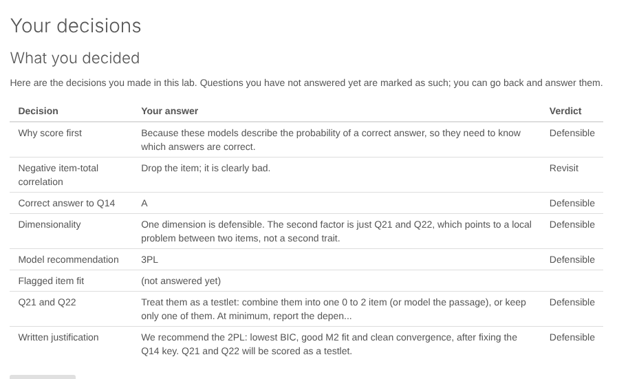

```{r, include = FALSE}
knitr::opts_chunk$set(collapse = TRUE, comment = "#>", fig.width = 7,
                      fig.height = 4.5, dpi = 96, out.width = "100%",
                      message = FALSE, warning = FALSE)
```

Each figure below is made by the code above it, with data that ships with
mirt or mirtverse. Every plot is a ggplot2 object, so you can change its
theme, labels and colours with ordinary ggplot2 code.

```{r setup}
library(mirtverse)
data <- expand.table(LSAT7)
mod <- mirt(data, 1, itemtype = "2PL", verbose = FALSE)
```

## Outputs to share

These run in a browser with nothing installed.

| Output | Made with | Example |
|---|---|---|
| Interactive results dashboard | `mv_dashboard()`, `export_dashboard()` | [Open the live dashboard](../dashboard/sat12-demo.html) |
| Printable cheat sheet | Two pages, by task | [PDF](../cheatsheet/mirtverse-cheatsheet.pdf) |
| Interactive teaching labs | `run_lab()` | [Teaching labs](teaching-labs.html) |
| Online book | Worked examples and exercises | [Read the book](../book/index.html) |

[](../dashboard/sat12-demo.html)

## Choosing a model

`select_model()` compares candidate models and explains its choice.

```{r select-model}
sel <- select_model(data)
autoplot(sel)
```

## Item curves

```{r trace}
gg_trace(mod)
```

## Test and item information

```{r info}
gg_info(mod)
```

```{r info-items}
gg_info(mod, type = "items")
```

## Wright map

People and items on one scale.

```{r wright, fig.height = 5}
gg_wright(mod)
```

## Item fit

```{r itemfit}
gg_itemfit(mod)
```

## Observed versus expected

```{r empirical}
gg_empirical(mod, item = 3)
```

## Local dependence

```{r q3}
gg_q3(mod)
```

## Score distribution

```{r scores}
gg_scores(mod)
```

## Item health card

A one-page summary of a single item for review meetings, with a traffic-light
status.

```{r item-card, fig.width = 12, fig.height = 7.2}
sci <- mirt(Science, 1, verbose = FALSE)
item_card(sci, "Work")
```

## Differential item functioning

```{r dif}
set.seed(1)
a <- matrix(rlnorm(8, 0.2, 0.3)); d <- matrix(rnorm(8))
d2 <- d; d2[1] <- d2[1] - 1
dif_data <- rbind(simdata(a, d, 400, itemtype = "2PL"),
                  simdata(a, d2, 400, itemtype = "2PL"))
res <- dif(dif_data, group = rep(c("F", "M"), each = 400))
gg_dif(res)
```

## Response times

```{r rt}
sim <- sim_rt(N = 500, J = 10, rapid = 0.05, seed = 1)
rt_mod <- mirt(sim$responses, 1, verbose = FALSE)
fit <- fit_rt(rt_mod, sim$rt)
autoplot(fit)
```

## Teaching labs

The labs run in RStudio's viewer or a browser. See
[Teaching labs](teaching-labs.html) for all ten.


